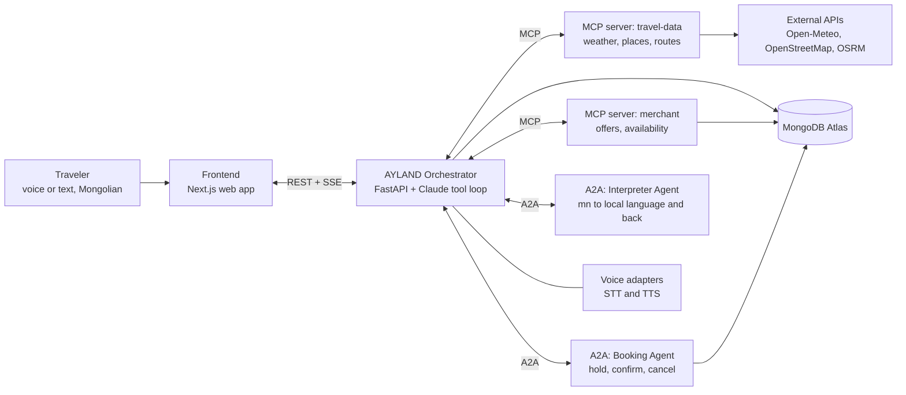
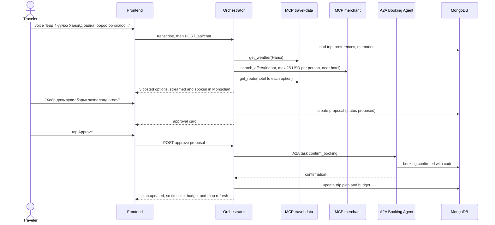

# AYLAND: Team Handbook

> **Аяллыг тань хөнгөвчлөх анд.** *A friend that makes your travel easier.*
>
> Team **Morgensonne** 🌅 · Hackathon theme: **Agentic Commerce** · Repo: [RedonaNova/AYLAND](https://github.com/RedonaNova/AYLAND)

This handbook is our single source of truth for **what** we build, **how** the pieces fit together, and **in what order** we build them.

- **First time here?** Read §1 to §4 (about 10 minutes).
- **While coding,** keep §7 (repo layout), §8 (contracts) and §10 (roadmap) open.
- **Status:** v1.10 draft (2026-10-03). Anything marked *Proposed* gets confirmed at kickoff (see §6). A clickable **web demo v0** (mock orchestrator) lives on the `demo` branch; see §10 and §12.

---

## Contents

1. [TL;DR](#1-tldr)
2. [The concept](#2-the-concept)
3. [The demo we are building toward](#3-the-demo-we-are-building-toward)
4. [Scope](#4-scope)
5. [Architecture](#5-architecture)
6. [Tech stack and decisions](#6-tech-stack-and-decisions)
7. [Repository layout](#7-repository-layout)
8. [Contracts v1](#8-contracts-v1)
9. [Team and workstreams](#9-team-and-workstreams)
10. [Roadmap: milestones and tasks](#10-roadmap-milestones-and-tasks)
11. [Ways of working](#11-ways-of-working)
12. [Local setup](#12-local-setup)
13. [Demo-day checklist](#13-demo-day-checklist)
14. [Risks and mitigations](#14-risks-and-mitigations)
15. [Glossary and references](#15-glossary-and-references)

---

## 1. TL;DR

- **What:** AYLAND is an AI travel companion for independent Mongolian travelers. It does more than suggest. It **plans, compares, books with your consent, re-plans when things change, and interprets** for you in the local language.
- **The magic moment:** a traveler says in Mongolian *"Бид 4-үүлээ Ханойд байна, бороо орчихлоо, өнөөдөр 100$ дотор юу хийж болох вэ?"* ("The four of us are in Hanoi, it's raining, what can we do today for under $100?"). AYLAND checks the real weather, the group's plan and local offers, proposes costed options and books one after approval. The day's plan then updates itself.
- **Core tech:** **MongoDB** holds memory and state. **MCP** supplies tools and data. **A2A** lets agents work together. **Claude** does the reasoning.
- **Golden rule:** by milestone **M4** the magic moment must work end to end (by text). Everything after that is a bonus.

---

## 2. The concept

The original concept (in Mongolian) is [docs/concept/Morgensonne.docx](docs/concept/Morgensonne.docx). English summary:

**What is new.** Today's travel apps give you lists and leave the work to you. AYLAND takes your goal (where, when, budget, travel style) and runs the whole trip. It researches flights, stays, transport, food and attractions, compares them, recommends the best fit and, **with your permission**, books them. If the weather, your location, budget or schedule changes mid-trip, it re-plans routes and bookings. It speaks Mongolian and acts as an **interpreter** with locals. It is one smart travel partner for the whole journey.

**Value created.**

| For | Value |
|---|---|
| Travelers | Less time planning, a personal trip, and everything (plans, tickets, bookings) in one place |
| Merchants and service providers | Reach the right traveler at the right moment, which means more bookings and sales |
| Travel ecosystem | Stays, transport, food and attractions that were separate become one connected flow, which gives **small and local businesses** a new channel to travelers |

### 2.1 The 14 agent capabilities and what we build this hackathon

| # | Capability (from the concept doc) | Level | Where it lives |
|---|---|---|---|
| 1 | Understand trip goals: budget, dates, interests, group size, style | **Must** | Orchestrator prompt, `users` and `trips` |
| 2 | Route planning: order, paths, timing | Should | `get_route` tool, planner prompt |
| 3 | Search flights, stays, transport, attractions via real APIs | **Must** for activities, weather and places. Stretch for flights and hotels | MCP `travel-data`, MCP `merchant` |
| 4 | Compare options by price, location, rating, time, conditions | **Must** | Orchestrator reasoning over tool results |
| 5 | Personalized recommendations for the group | **Must** | `memories`, traveler preferences |
| 6 | Budget tracking | **Must** | `get_budget_status`, budget meter UI |
| 7 | Booking with the user's consent | **Must** ★ | Approval card, then the A2A Booking Agent |
| 8 | Real-time re-planning (weather, delays, closures, budget) | **Must** ★ | `update_trip_plan`, weather tool |
| 9 | Daily itinerary | Should | Timeline UI, planner |
| 10 | Maps and directions | Should | `get_route`, Leaflet map |
| 11 | Interpreter (Mongolian ⇄ local language; **English first**, other languages later) | **Must** | A2A Interpreter Agent, STT/TTS |
| 12 | All trip info in one place (tickets, bookings, addresses, confirmations) | **Must** | MongoDB `trips` and `bookings`, trip panel |
| 13 | Coordinate group preferences | Should: group size and shared budget. Stretch: per-person preferences | `trips.travelers` |
| 14 | Proactively suggest the next step | Should | Nudge cards after events (rain, booking) |

★ = part of the magic moment.

---

## 3. The demo we are building toward

Every task in this plan serves this story of about three minutes. **If a task does not make this demo better or more reliable, it goes to the stretch list.**

**Setting:** Bat and three friends (four Mongolians) are on day 3 of a Hanoi trip that AYLAND planned. Today's plan is mostly outdoors, and they have $100 left for the day.

| Act | What happens | What the judges see | Capabilities |
|---|---|---|---|
| **0. Context** (15s) | Open the app: today's timeline, budget and map | A real trip, not an empty chat box | 9, 12 |
| **1. Rain** (15s) | The weather turns to rain (DEMO_MODE scenario). AYLAND flags it on its own: *"Бороо орж эхэллээ. Өнөөдрийн хоёр гадаа хөтөлбөрт нөлөөлөх тул өөрчлөх үү?"* | The agent notices the change without being asked | 8, 14 |
| **2. Ask** (60s) | Bat holds the mic: *"Бид 4-үүлээ Ханойд байна, бороо орчихлоо, өнөөдөр 100$ дотор юу хийж болох вэ?"* | The trace panel lights up: weather, trip, offers, routes. Two or three options appear with per-person and total cost and travel time, spoken back in Mongolian | 1, 3, 4, 5, 6, 10 |
| **3. Act** (45s) | *"Хоёр дахь хувилбарыг захиалаад өгөөч."* An approval card appears and Bat taps **Approve** | An A2A call to the Booking Agent returns a confirmation code. The timeline re-flows, the budget meter drops and the map pin moves | 7, 8, 12 |
| **4. Companion** (45s) | Interpreter mode at the venue: Mongolian ⇄ English, by voice with large text on screen | A real conversation across two languages | 11 |
| **Close** (15s) | *"Not a chatbot. An agent that decides and acts, with your consent. MongoDB remembers, MCP connects, A2A collaborates."* | | |

**Why we need DEMO_MODE:** it may not be raining in Hanoi on demo day. The weather tool supports a scenario override (`data/scenarios/hanoi_rain.json`), so the story is reproducible. Everything else stays real: the tool calls, the reasoning, the booking and the database writes. If judges ask, we say so openly.

---

## 4. Scope

**Must** (the demo breaks without these)
- Mongolian chat (text) with streamed replies
- MCP servers: `travel-data` (weather with scenario override, places, routes) and `merchant` (offer search, availability)
- Trip state in MongoDB: plan, budget, bookings, and a re-plan tool
- Consent-gated booking through the A2A Booking Agent
- UI: chat, option cards, approval card, today's timeline, budget meter, agent trace panel
- Mongolian voice in and out, and interpreter mode (mn ⇄ en for now; any visited country's language later)
- Seed data for Hanoi and a one-command demo reset

**Should** (makes it impressive)
- Map with pins and a route line
- Proactive nudges ("it's raining", "leave in 10 minutes")
- Atlas Vector Search for semantic offer search and agent memory
- Per-traveler interests inside the group

**Could** (stretch, only after M4 is tagged)
- A pre-trip planning flow from scratch, including flights and stays through a real API in test mode
- An A2A Transport Agent (ride options)
- Payment mandates in the style of AP2 (Agent Payments Protocol, an A2A extension for agent-initiated payments)
- A merchant portal where local businesses list their own offers
- MongoDB Change Streams for live sync across devices
- Prices shown in MNT as well

**Won't** (not this hackathon)
- Real payments, real bookings with real merchants, user accounts beyond one demo user, a native mobile app

---

## 5. Architecture



### 5.1 Components

| Component | Tech | Responsibility | Port |
|---|---|---|---|
| Frontend | Next.js, TypeScript, Tailwind | Chat and voice UI, timeline, budget, map, trace panel, interpreter screen | 3000 |
| Orchestrator | Python, FastAPI, Claude Agent SDK (Claude Code CLI login), OyuLLM | The main AYLAND agent. Understands the goal, calls tools, streams events and owns the consent gate | 8000 |
| MCP `travel-data` | Python, MCP SDK (FastMCP) | Weather (Open-Meteo plus scenario override), places, routes | 8201 |
| MCP `merchant` | Python, MCP SDK (FastMCP) | Offer catalog search and availability, backed by MongoDB | 8202 |
| A2A Booking Agent | Python, `a2a-sdk` | Hold, confirm and cancel bookings; writes to `bookings` | 8301 |
| A2A Interpreter Agent | Python, `a2a-sdk`, Orchu MT (Novelsoft, mn ⇄ en) | Translate Mongolian ⇄ English (other languages, and Claude for travel context, later) | 8302 |
| Voice adapters | Module inside the orchestrator | Anir STT and tsuurAI TTS (Novelsoft, `api.oyu.so`) | none |
| Database | MongoDB Atlas (free M0 cluster) | Users, trips, offers, proposals, bookings, memories, agent events | cloud |

### 5.2 Why each technology (for us and for the pitch)

- **MongoDB Atlas** is the agent's memory and the trip's source of truth. Documents fit itineraries naturally (a trip has days, a day has items). A geospatial index answers "near our hotel", Atlas Vector Search answers "indoor things for a rainy day" and recalls preferences, and `agent_events` is an audit log of every action the agent takes.
- **MCP** is how the agent gets tools and data. Each data source is an MCP server, so any agent can reuse the tools (our orchestrator, the Booking Agent, even Claude Desktop), and each one is testable on its own in the MCP Inspector.
- **A2A** is how agents cooperate. The orchestrator hands booking and interpretation to specialist agents that publish **Agent Cards**. The same open interface would let a real merchant or transport company plug in their own agent, which is our ecosystem story.
- **Claude** handles multi-step reasoning and tool use; we reach it through the Claude Code CLI login (Claude Agent SDK), so no API key is needed.
- **Novelsoft OyuLLM, Anir STT and tsuurAI TTS** are the Mongolian language layer the hackathon requires: OyuLLM (OpenAI-compatible, tool calling) for Mongolian text, Anir for speech in, tsuurAI for speech out. M0-5 decides how work is split between OyuLLM and Claude.

### 5.3 The magic moment, step by step



### 5.4 Agent design principles

1. **Tools supply facts, the model supplies judgment.** Weather, prices, availability and travel times always come from tools. The model never invents a price.
2. **Propose is not execute (the consent gate).** The model can only *create a proposal*. Holding or confirming a booking happens only through `POST /api/proposals/{id}/approve`, which the user triggers. This is enforced in code, twice (orchestrator and Booking Agent), not only in the prompt. Plan edits that spend no money are allowed without approval because they are versioned and reversible.
3. **Everything is logged.** Every tool call, A2A call and plan change is written to `agent_events` and streamed to the UI trace panel. This is both our debugging log and our proof to judges that the agent is really acting.
4. **Mongolian first.** Replies default to Mongolian and stay short and easy to speak aloud (they go through TTS). Money is shown as total and per person, in USD.
5. **Always end with a next step.** Every reply suggests what to do next (capability 14).

---

## 6. Tech stack and decisions

Change the status column when the team agrees.

| ID | Decision | Choice | Status |
|---|---|---|---|
| D1 | LLM | **OyuLLM** (Novelsoft, required by the hackathon) plus **Claude** `claude-opus-5-5` through the Claude Code CLI login (Claude Agent SDK, no API key). Who does what is set by the M0-5 spike | Proposed |
| D2 | Backend language | Python 3.12 (installed and managed by `uv`) with FastAPI | Proposed |
| D3 | Frontend | Next.js (App Router), TypeScript, Tailwind; Leaflet with OpenStreetMap tiles for the map (no key needed) | Proposed |
| D4 | Voice (Mongolian STT and TTS) | **Anir STT** and **tsuurAI TTS** (Novelsoft, required). Voice and model tuned by the M0-4 spike. English side of the interpreter: browser Web Speech API (en-US); translation by Orchu (mn ⇄ en, about 0.4–0.8 s per sentence, tested 2026-10-01) | Confirmed (hackathon rule) |
| D5 | Places and routing data | OpenStreetMap (Overpass, OSRM), free. Google Maps Platform only if someone already has a key | Proposed |
| D6 | MCP transport | Streamable HTTP, so each server runs as its own process and can be tested alone | Proposed |
| D7 | Demo city and currency | Hanoi, USD | Confirmed (concept doc) |
| D8 | MongoDB driver | PyMongo async API (`AsyncMongoClient`). Motor is deprecated | Proposed |
| D9 | Hackathon logistics | See §6.1 | Confirmed (event page) |

**Backend libraries:** `fastapi`, `uvicorn`, `claude-agent-sdk` (Claude through the Claude Code CLI), `openai` (OyuLLM is OpenAI-compatible), `mcp` (official MCP SDK), `a2a-sdk` (official A2A SDK), `pymongo`, `pydantic`, `pydantic-settings`, `httpx`, `ruff`, `pytest`.

**Frontend libraries:** `next`, `react`, `tailwindcss`, `leaflet` and `react-leaflet`, plus shadcn/ui components if we want them.

**Novelsoft APIs** ([dev.oyu.so](https://dev.oyu.so), one key from [oyu.so/account/apikeys](https://oyu.so/account/apikeys), base `https://api.oyu.so/v1`, `Authorization: Bearer`):
- **OyuLLM**: `POST /chat/completions`, model `oyuLLM`, OpenAI-compatible with streaming and tool calling (use the `openai` SDK with `base_url`).
- **Anir STT**: `POST /audio/transcriptions` (multipart `file`, WAV/MP3/OGG, ≤100 MB) returns `{text}`; real-time over WebSocket `/audio/stream` with 16 kHz PCM.
- **tsuurAI TTS**: `POST /audio/speech` `{text ≤800 chars, voice: mbspeech | baseline | mn1h}` returns WAV.
- Also there: **Orchu** translation mn ⇄ en (`/translations`) and an MCP server at `https://api.oyu.so/mcp` that exposes these tools to any agent.

**Spikes.** `npm run check` pings every service; `npm run spike:llm` (M0-5) and `npm run spike:voice` (M0-4) write their results to `docs/spikes/`.

> **Notes for the agent-core owner (D1)**
> - Claude runs through the **Claude Agent SDK** (`claude-agent-sdk`), which drives the local `claude` CLI and uses its login. `backend/ayland/llm/claude.py` finds the CLI (`CLAUDE_CLI_PATH`, then PATH, then the VS Code extension's copy). Everyone running the orchestrator needs Claude Code installed and logged in.
> - Turn off what we don't want from Claude Code: `tools=[]` (no built-in file or shell tools), `setting_sources=[]` (no user settings or CLAUDE.md), a neutral `cwd`, and in `env` `ENABLE_CLAUDEAI_MCP_SERVERS=false` plus `CLAUDE_CODE_DISABLE_AUTO_MEMORY=1`: with a claude.ai login the CLI otherwise loads the account's own connectors (Gmail, Drive…) into the agent (`ISOLATED_ENV` in `llm/claude.py`). `ENABLE_TOOL_SEARCH=false` keeps our few tools loaded up front instead of searched for.
> - Our MCP servers plug straight in through `mcp_servers` (`{"type": "http", "url": ...}`); local tools (`get_trip`, `propose_booking`, ...) through `create_sdk_mcp_server`. The consent gate also sits in `can_use_tool`, on top of the approve endpoint.
> - Keep one `ClaudeSDKClient` session per trip conversation: each `query()` starts a CLI process (about 4–6 s for a one-line reply on 2026-09-30). Stream with `include_partial_messages=True`; tune latency with `effort` (`low` for quick turns).
> - On `claude-opus-5-5`, thinking can't be switched off and forced tool choice is rejected; steer with instructions. Never edit earlier turns of a conversation (the history must stay append-only).
> - A public deployment would need an API key or another login model; the CLI login is fine for our own demo machine.

### 6.1 Hackathon facts (D9, from [the event page](https://nerus.tv/e/agentic26))

| | |
|---|---|
| Registration closes | **2026-10-02**; selected teams hear on 10-04 |
| Build day | **2026-10-05** (one day); submissions due the same day; finals and awards 10-06 |
| Team size | Up to **3** people (use the three-person split in §9) |
| Demo | **8 minutes**: 1 min problem and solution, **3 min live demo**, 1 min architecture and tech, 3 min judge Q&A |
| Required tech | OyuLLM, Anir STT, tsuurAI TTS (Mongolian); MongoDB; MCP; A2A; multi-step agent behaviour |
| Submission | Repo with README and install steps, architecture diagram, agent workflow explanation, MongoDB usage notes, MCP/A2A/interoperability details, a **2–3 minute demo video** link |
| Judging | Problem and use case 15% · Agent architecture 15% · OyuLLM and MongoDB usage 10% · Open interoperability 15% · Technical execution 15% · Innovation and demo clarity 10% · Public vote 20% |
| Rules | Sandbox or simulated transactions only; **pre-written code is allowed if disclosed**; any language, LLM or framework; AI coding assistants allowed |
| Prizes | ₮5M / ₮3M / ₮2M |

---

## 7. Repository layout

We build this structure in task M0-6. Keep new code inside it; if something doesn't fit, raise it in team chat before adding a new top-level folder.

```
AYLAND/
├── HANDBOOK.md               ← you are here
├── README.md                 ← short intro + quick start
├── .env.example              ← every env var with no secrets (M0-6)
├── package.json              ← root scripts: setup, dev, seed, check (M0-6)
├── demo-up.ps1               ← runs the live demo on this PC (booking :8401, API :8100, web :3100, tunnel)
├── docs/
│   ├── concept/Morgensonne.docx   ← original concept (Mongolian)
│   ├── spikes/               ← M0-4 / M0-5 results (audio stays local)
│   ├── demo-script.md        ← exact words and clicks for the demo (M6)
│   └── pitch/                ← deck export (M6)
├── frontend/                 ← Next.js + TypeScript + Tailwind
│   ├── e2e/                  ← Playwright golden-path checks (npm run test:e2e)
│   └── src/
│       ├── app/              ← pages: / (chat), /trip, /interpreter, /agents
│       ├── components/       ← ChatPanel, Composer (voice), OptionCard, ApprovalCard,
│       │                       Timeline, BudgetMeter, AgentSteps (trace), MapView
│       ├── i18n/mn.ts        ← all Mongolian UI strings in one place
│       └── lib/
│           ├── api.ts        ← AylandApi (§8.4): mock or live, switched in the demo controls
│           ├── types.ts      ← §8 shapes, snake_case
│           ├── live/         ← HTTP client (long polls), WAV recorder, browser speech (English side)
│           └── mock/         ← in-browser scripted orchestrator (the stage-safe fallback)
├── backend/                  ← one Python project (uv), several processes
│   ├── pyproject.toml
│   ├── ayland/
│   │   ├── config.py         ← reads .env, the only place that does
│   │   ├── db/               ← Mongo client, Pydantic models (§8.1), repositories
│   │   ├── orchestrator/     ← FastAPI app, agent loop, prompts/, SSE events
│   │   ├── mcp_servers/      ← common.py: Point {lon, lat}, caching, ToolError
│   │   │   ├── travel_data/  ← get_weather (weather.py), search_places (places.py), get_route (routes.py)
│   │   │   └── merchant/     ← search_offers, get_offer, check_availability (ranking in catalog.py)
│   │   ├── a2a_agents/       ← base.py: Agent Card, skill table, JSON-RPC app, `ping`
│   │   │   ├── booking/      ← hold / confirm / cancel
│   │   │   └── interpreter/  ← translate (Orchu)
│   │   └── voice/            ← STT and TTS provider adapters
│   ├── scripts/seed.py       ← loads data/seed into MongoDB; also the demo reset
│   ├── spikes/               ← M0 measurements: check_services, llm_spike, voice_spike
│   └── tests/
└── data/
    ├── seed/                 ← demo user, Hanoi trip, merchants, offers (JSON)
    └── scenarios/            ← DEMO_MODE fixtures, e.g. hanoi_rain.json
```

---

## 8. Contracts v1

Contracts let everyone build in parallel against agreed shapes. **We freeze v1 at kickoff (M0-7).** After that, any change goes in the same PR as an update to this section, plus a heads-up in team chat.

**General rules**
- JSON field names are `snake_case` everywhere: MongoDB, Python and the API. The frontend does not convert them.
- Money: `{ "amount": 12.5, "currency": "USD", "per": "person" | "group" }`, rounded to 2 decimals. Always include `per` so per-person and group prices are never confused.
- Time: ISO 8601 with an offset. Each trip stores its timezone (`Asia/Ho_Chi_Minh`).
- Locations: GeoJSON `{ "type": "Point", "coordinates": [lon, lat] }`. Longitude comes first.

### 8.1 MongoDB collections

```js
users {
  _id, name, language: "mn",
  preferences: { interests: [], food: [], pace: "relaxed" | "normal" | "packed", notes }
}

trips {
  _id, owner_id, title,
  destination: { city: "Hanoi", country: "VN", timezone: "Asia/Ho_Chi_Minh", location },
  travelers: [ { name, interests: [] } ], party_size: 4,
  budget: { currency: "USD", total, daily_limit, spent },
  hotel: { name, address, location },
  days: [ { date: "YYYY-MM-DD", items: [PlanItem] } ],
  version, updated_at
}
PlanItem {
  item_id, start, end, kind: "activity" | "meal" | "transport" | "stay" | "free",
  title, place: { name, address, location }, cost: Money, indoor: bool,
  status: "planned" | "proposed" | "booked" | "cancelled" | "done",
  offer_id?, booking_id?, source: "seed" | "agent" | "user"
}

merchants  { _id, name, kind, city, contact }

offers {                                   // merchant catalog, seeded
  _id, merchant_id, city, title, title_mn, description,
  category: "activity" | "food" | "culture" | "wellness" | "transport",
  tags: ["indoor", "rainy-day", "family", "food", ...],
  price: Money, duration_min, location, address, rating, opening_hours,
  slots: [ { start, capacity_left } ], cancellation_policy,
  embedding?: [float]                      // Should: Atlas Vector Search
}

proposals  { _id, trip_id, offer_id, slot_start, party_size, total: Money,
             status: "proposed" | "approved" | "rejected" | "expired", created_at }

bookings   { _id, trip_id, proposal_id, offer_id, status: "held" | "confirmed" | "cancelled",
             confirmation_code, total: Money, consent: { approved_at, method: "tap" | "voice" }, created_at }

memories   { _id, user_id, trip_id?, kind: "preference" | "fact" | "feedback", text, embedding?, created_at }

messages   { _id, trip_id, role, content, run_id, ts }  // the turn's text; Claude's own history lives in its CLI session

trip_versions { _id, trip_id, version, days, reason, ts }   // the days as they were before each plan change (undo)

agent_events { _id, trip_id, run_id, type: "tool" | "a2a" | "plan" | "booking" | "llm",
               name, input, output_summary, ok, ms, ts }
```

**Indexes:** `offers.location` (2dsphere), `proposals.trip_id`, `bookings.trip_id`, `messages (trip_id, ts)`, `agent_events (trip_id, ts)`, `trip_versions (trip_id, version)`. *Should:* Atlas Vector Search indexes on `offers.embedding` and `memories.embedding`.

### 8.2 Tools

Tool inputs take points as `{ lon, lat }` (the model can't swap a named pair); outputs stay GeoJSON. Every result carries a short Mongolian `summary` for the trace panel. Anticipated failures (unknown city or offer, OpenStreetMap down) come back as readable tool errors.

**MCP server `travel-data`** (port 8201, `/mcp`, Streamable HTTP, stateless)

| Tool | Input | Output |
|---|---|---|
| `get_weather` | `city` or `lat`/`lon`, `hours_ahead` | `condition`, `precip_prob`, `temp_c` now, `until` (when rain stops), `hourly[]`; `scenario: true` when the DEMO_MODE override is active (`data/scenarios/<DEMO_SCENARIO>.json`), else Open-Meteo |
| `search_places` | `near`, `query`, `kind` (cafe, pharmacy, atm, museum…), `radius_m`, `limit` | `places: [ { name, name_en?, address, location, kind, distance_m, source: "osm" } ]` (Overpass) |
| `get_route` | `origin`, `destination`, `mode` (`walk` / `drive`) | `{ distance_m, duration_min, cost?, source }`: OSRM on OpenStreetMap roads, drive ×1.4 for city traffic plus a group car fare; an offline estimate if OSRM is down |

**MCP server `merchant`** (port 8202, `/mcp`)

| Tool | Input | Output |
|---|---|---|
| `search_offers` | `query` (Mongolian or English), `city`, `tags[]` (all required), `max_price_per_person`, `party_size`, `near`, `radius_m`, `time_window` (`"13:00-19:00"`), `date` | `offers[]` best first, each with `price_per_person`, `price_total` for the party, `distance_m` (2dsphere `$geoNear`) and only the slots that fit the window, the party and the clock |
| `get_offer` | `offer_id` | Full offer |
| `check_availability` | `offer_id`, `date`, `party_size` | Open slots with `start`, `end`, `capacity_left` |

**Orchestrator local tools.** These are not MCP, because they touch our own state and the consent gate.

| Tool | Input | Output |
|---|---|---|
| `get_trip` | (bound to the trip) | Today's plan with item ids, times and places (lon/lat), travelers, party size, hotel (lon/lat) |
| `get_budget_status` | (bound to the trip) | Today's `{ limit, spent, booked, planned, remaining }` |
| `present_options` | `options[]`: `offer_id`, `slot_start`, `reason`, `travel_mode`, `travel_min`, `travel_cost_usd?` | Emits the `options` event; offer, slot and price come from the catalog, so a card never shows a price the merchant didn't publish |
| `update_trip_plan` | `changes[]`: `cancel` / `move` (`start`, `end`, optional `date`) / `add` (`item`) / `replace` (`item_id`, `item`); `reason`; optional `date` | New `version`, the changed ids and today's budget; emits `plan.updated` on the trip events. Only `planned` items change (booked ones go through the consent gate); new items are free or pay-on-site, never offers; clashes, past times and going over the daily limit are refused with a reason |
| `propose_booking` | `offer_id`, `slot_start`, `party_size` (default the party) | A proposal with `status: proposed` (any other open one expires), `fits_budget`, `remaining_after_usd`; emits `proposal.created { proposal, offer }` |
| `undo_plan_change` | (none) | Brings the previous version back as a new version (so an undo can be undone); refused once a booking changed since |
| `remember` / `recall` *(Should)* | `text` / `query` | Writes a memory / returns the top-k memories |

### 8.3 A2A agents

**Calling a skill.** A2A routes messages, not skills, so every AYLAND request carries one data part `{"skill": "<id>", ...inputs}` and the agent answers with one data message (the A2A "immediate response"). Both sides use `ayland/a2a_agents/skills.py`; the orchestrator calls `ayland/orchestrator/a2a.py` → `call_skill(base_url, skill, inputs)`. Agents speak JSON-RPC at `/a2a/jsonrpc` and serve their card at `/.well-known/agent-card.json` (a2a-sdk 1.x, A2A protocol 1.0).

**AYLAND Booking Agent** (port 8301) publishes an Agent Card with these skills (M1 ships `ping`; the rest arrive in M4):

| Skill | Input | Output |
|---|---|---|
| `hold_booking` | `offer_id`, `slot_start`, `party_size` | `{ hold_id, expires_at }` |
| `confirm_booking` | `proposal_id` | `{ booking_id, confirmation_code }`. **Refuses unless the proposal is `approved` in MongoDB** |
| `cancel_booking` | `booking_id` | `{ status }` |

**AYLAND Interpreter Agent** (port 8302; M2 ships `translate` on Orchu, mn ⇄ en; `POST /api/interpret` calls it over A2A and falls back to Orchu directly if the agent is down):

| Skill | Input | Output |
|---|---|---|
| `translate` | `text`, `source_lang`, `target_lang`, `context?` | `{ text, pronunciation_hint? }` |
| `phrasebook` *(Should)* | `situation`, `target_lang` | Useful phrases for the situation |

### 8.4 Orchestrator HTTP API (for the frontend)

| Method | Path | Purpose |
|---|---|---|
| POST | `/api/chat` | `{ trip_id, message }` returns an SSE event stream (below) |
| POST | `/api/chat/runs` | The same turn, started in the background: returns `{ run_id }` (what the web client uses) |
| GET | `/api/chat/runs/{run_id}/events?cursor=` | Long poll (≤20 s): `{ events[], cursor, done }`, the same events as the SSE stream; works through proxies that buffer streams |
| DELETE | `/api/chat/runs/{run_id}` | Cancels a turn (reset or mode switch mid-turn) |
| POST | `/api/voice/transcribe` | Audio (multipart) and `lang`; returns `{ text }` |
| POST | `/api/voice/speak` | `{ text, lang }`; returns audio |
| POST | `/api/interpret` | `{ text, source_lang, target_lang }`; returns `{ text }` |
| GET | `/api/trips/{trip_id}` | Trip with plan, budget and bookings |
| POST | `/api/proposals/{id}/approve` | Consent: calls the Booking Agent over A2A, updates the plan, emits events |
| POST | `/api/proposals/{id}/reject` | Rejects an open proposal (409 if it was already decided or replaced) |
| GET | `/api/trips/{trip_id}/events` | *(Should)* SSE stream of plan and booking updates and nudges |
| GET | `/api/trips/{trip_id}/events/poll?cursor=` | The same events as a long poll (≤20 s): `{ events[], cursor, reset }`. The web client uses this, because Cloudflare quick tunnels buffer streamed responses until they end |
| GET | `/api/health` | MongoDB, Claude CLI, Novelsoft key, both A2A agents (`ping`) and both MCP servers (`tools/list`), DEMO_MODE |
| POST | `/api/demo/reset` | Re-seeds demo data (DEMO_MODE only; 403 otherwise) |
| POST | `/api/demo/scenario` | `{ weather }` set to `"rain"` or `"clear"` switches the scenario (DEMO_MODE only; 403 otherwise) |

**SSE event types**

| Event | Payload |
|---|---|
| `message.delta` | `{ text }` |
| `message.done` | `{ message_id }` |
| `tool.start` | `{ run_id, name, input }` |
| `tool.end` | `{ run_id, name, ok, summary, ms }` |
| `a2a.call` | `{ agent, skill, status }` |
| `proposal.created` | `{ proposal }` |
| `plan.updated` | `{ trip_id, version, changed_item_ids }` |
| `booking.confirmed` | `{ booking }` |
| `nudge` | `{ text, actions[] }` |
| `error` | `{ message }` |

**v1.1 additions (found while building the web demo; confirm at M0-7)**

| Change | Why |
|---|---|
| New event `options`: `{ run_id, options: [ { rank, offer, slot_start, slot_end, price_total, travel: { mode, duration_min, cost? }, reason } ] }` | The option cards (M2-C2) had no event to arrive in |
| `tool.start` and `tool.end` carry `call_id` | Parallel calls of the same tool (three `get_route`s) must be matched start to end |
| `GET /api/trips/{trip_id}` returns `{ trip, bookings, weather, now }` | The weather card and the "now" line need live context; `now` is `DEMO_NOW` in demo mode |
| `POST /api/proposals/{id}/approve` body `{ method: "tap" \| "voice" }` and returns the same SSE stream as chat | Records how consent was given; streams the A2A call, `booking.confirmed`, `plan.updated` and the summary |
| The trip event stream carries `nudge` and `plan.updated` | Act 1 (the unprompted rain alert) needs a push outside the chat stream |

---

## 9. Team and workstreams

Fill in names at kickoff. One owner per workstream; everyone helps at integration points.

| Workstream | Owns | Owner |
|---|---|---|
| **A: Agent core** | Orchestrator, prompts, tool loop, consent gate, nudges | _TBD_ |
| **B: Data and tools** | MongoDB models and indexes, seed data, both MCP servers, vector search | _TBD_ |
| **C: Experience** | Next.js UI, voice capture and playback, timeline, map, trace panel, interpreter screen | _TBD_ |
| **D: Agents and voice** | A2A Booking and Interpreter agents, STT and TTS adapters | _TBD_ |
| **Demo and pitch** | Demo script, deck, rehearsals, submission | Shared, led by _TBD_ |

- **Three people?** Split D: A takes the Booking Agent, B takes the Interpreter Agent and voice adapters.
- **Five people?** Give Demo and pitch a dedicated owner from M3 onward.

**Who edits which folders** (three people; this is what keeps parallel work conflict-free, see §11):

| Workstream | Folders it owns | What is left for it (from 2026-10-03) |
|---|---|---|
| **A: Agent core + Booking Agent** | `backend/ayland/orchestrator/`, `backend/ayland/a2a_agents/booking/`, `backend/ayland/budget.py` | M3 live check; **M4-D1** hold/confirm/cancel; **M4-A1** approve endpoint (A2A confirm, plan → booked, budget, events, Mongolian summary); M5-A1 "time to leave" nudge |
| **B: Data, tools, voice, OyuLLM** | `backend/ayland/mcp_servers/`, `backend/ayland/db/`, `data/`, `backend/ayland/voice/`, `backend/ayland/llm/`, `backend/ayland/a2a_agents/interpreter/` | Voice hand test (M1-D2); MCP Inspector (M2-B3); **D1: a real job for OyuLLM** (required tech, 10% of judging; not used in the live flow yet); M3-B2 vector search and M3-B3 memories *(Should)* |
| **C: Experience + demo** | `frontend/`, `docs/`, `demo-up.ps1` | Live approval card (M4-C1, with A); design pass with `frontend-design`; Vercel deploy (repo owner); M6 demo script, deck, backup video |

Shared files, edited in small separate commits and announced in chat: `HANDBOOK.md`, `package.json`, `.env.example`, `backend/ayland/db/models.py` and `frontend/src/lib/types.ts` (the §8 contracts), `backend/ayland/orchestrator/tools.py` (A and B both add tools).

---

## 10. Roadmap: milestones and tasks

Times are **hours from kickoff (H0)** and assume a build window of about 24 hours. Rescale them once we confirm D9. Each milestone ends with an **exit check**. Do not start the next milestone's integration until the check passes on `main`.

| Milestone | Target | Exit check |
|---|---|---|
| **M0** Setup | H0 to H2 | Keys work, repo scaffolded, everyone runs it locally, D1 to D9 decided, contracts frozen |
| **M1** Walking skeleton | H2 to H5 | UI to orchestrator to Claude gives a streamed Mongolian reply; the seeded trip shows in the UI; A2A ping works |
| **M2** Tools via MCP | H5 to H9 | The rain question is answered with real tool calls, visible in the trace panel |
| **M3** Plan and budget | H8 to H12 | The agent re-plans; timeline and budget update live |
| **M4** ★ Magic moment (text) | H12 to H15 | Acts 2 and 3 run end to end from a fresh reset, 3 times in a row. Tag `v0.1-magic` |
| **M5** Voice and interpreter | H15 to H19 | The magic moment works by voice; the interpreter round trip mn ⇄ en works |
| **M6** Demo hardening | H19 to H24 | Feature freeze at H20, 3 rehearsals, backup video, submission done |

Tick a box only after the task's tests pass (offline first, then live, which spends Novelsoft credit and Claude usage); until then mark it *built*. Task IDs (M2-B1 and so on) go in branch names and PR titles.

> **M1 review (2026-10-02).** Seed completed (demo user, 28 merchants, 28 offers with descriptions, opening hours and slots on the three remaining days); `/api/demo/*` refuse when DEMO_MODE is off; voice adapters take `lang` (`ayland/voice`); SSE is sent `no-transform` with heartbeats and the web proxy no longer gzips it (it held live streams back); the trip event stream reconnects; failed turns show their reason.
>
> **Live slice (2026-10-02).** Live mode (demo controls → Live) runs on the real backend: Claude through the CLI login with `get_trip` and `get_budget_status` reading MongoDB, chat stored in `messages`, tool calls in `agent_events`, the rain nudge on the trip event stream, Anir for the mic, tsuurAI for Mongolian speech and Orchu for the interpreter. Option cards are live since M2; proposals and booking need M3–M4, until then the full magic moment runs in Mock mode. Measured: first rain question about 14 s (mostly thinking), follow-ups about 4 s.
>
> **Web demo v0 (2026-09-30).** The UI side of M1-C1, M2-C1, M2-C2, M3-C1, M3-C2, M4-C1, M5-C1 (simulated voice) and M5-C2 is built against an in-browser mock orchestrator that emits the §8.4 events. Those boxes stay unticked until each is wired to the real orchestrator and passes its milestone's exit check. `frontend/e2e/` already runs the Act 1 to 4 flow and is the starting point for M4-ALL.

### M0: Setup (H0 to H2)

- [ ] **M0-1** (all) Read §1 to §4. Install Git, Node.js 20+ and `uv`. Clone the repo **outside OneDrive, Dropbox or iCloud folders**, because syncing `node_modules` and `.venv` breaks things.
- [x] **M0-2** (B) Create the MongoDB Atlas free cluster `ayland`, a database user and network access. Share `MONGODB_URI` privately. Verified 2026-10-01 with `npm run check` (warm ping about 110–200 ms; the first connection takes about 1.5 s, so keep one client open).
- [x] **M0-3** (A) ~~Create an Anthropic API key~~ No key: Claude runs through each developer's Claude Code CLI login (Claude Agent SDK). Verified 2026-10-01 with `npm run check`.
- [ ] **M0-4** (D) Voice spike (§6): `npm run spike:voice` runs the demo lines through tsuurAI (all three voices) and Anir; record your own voice in `backend/spikes/recordings/1.wav`…`3.wav` for real accuracy. Pick the voice in D4. Needs `OYU_API_KEY`.
- [ ] **M0-5** (A) LLM spike: `npm run spike:llm` runs five Mongolian travel prompts on OyuLLM and Claude (effort `low` and `medium`) plus an OyuLLM tool-calling check; rate the answers in `docs/spikes/m0-5-llm.md`, then confirm D1 (who does what). Needs `OYU_API_KEY`.
- [x] **M0-6** (C) Scaffold the repo per §7: `create-next-app` in `frontend/`, a uv project in `backend/`, root `package.json` scripts, `.env.example`. Merge one small PR quickly so everyone can pull it.
- [ ] **M0-7** (all, 20 min) Walk through §8 together, adjust it, and mark it "frozen v1".
- [ ] **M0-8** (lead) Confirm D9: deadline, submission format, judging criteria, demo length. Fill in §9 names.

### M1: Walking skeleton (H2 to H5)

- [x] **M1-A1** FastAPI app with `POST /api/chat` streaming a Claude reply (`message.delta`, `message.done`). System prompt v0 covers the persona, Mongolian and the rules in §5.4. *(verified live 2026-10-03)*
- [x] **M1-A2** Store chat turns in `messages`. *(verified live 2026-10-03)*
- [x] **M1-B1** `ayland/db`: client, Pydantic models for §8.1, small repository functions. *(verified live 2026-10-03)*
- [x] **M1-B2** Seed data (`data/seed/hanoi.json`, `npm run seed`): the demo user; the Hanoi trip (today = the seed date, an outdoor-heavy plan, hotel in the Old Quarter); 25 to 30 realistic offers with a good share of indoor, rainy-day and budget options; and the merchants. `scripts/seed.py` must be idempotent so it doubles as the demo reset. *(verified live 2026-10-03)*
- [x] **M1-C1** Mobile-first chat screen that reads the SSE stream, plus a trip panel from `GET /api/trips/{id}`. *(verified live 2026-10-03; the chat now reads turns by long poll, §8.4)*
- [x] **M1-D1** Booking Agent skeleton that serves its Agent Card and a `ping` skill, plus an A2A client helper in the orchestrator that calls it. *(verified live 2026-10-03: ping 368 ms, also in /api/health)*
- [ ] **M1-D2** Voice adapter interface (`transcribe(audio, lang)`, `speak(text, lang)`) using the provider chosen in D4, exposed as `/api/voice/*`. *(built 2026-10-02; tick after the offline and live tests pass)*

### M2: Tools via MCP (H5 to H9)

> **M1 and M2 exit checks passed (2026-10-03, live, through the public quick tunnel).** One rain question in Live mode: get_trip, get_weather and get_budget_status in parallel, then search_offers, three get_route calls and present_options, all visible in the trace with timings; option cards at 19 s, the Mongolian reply done at 25 s, with the right prices and the $100 budget kept. One translation went over A2A to Orchu in 1.3 s. Still to run by hand: voice (M1-D2) and the MCP Inspector (M2-B3).

- [x] **M2-B1** MCP `travel-data`: `get_weather` (Open-Meteo plus the DEMO_MODE scenario), `search_places`, `get_route`. *(verified live 2026-10-03: weather scenario and OSRM routes in the rain turn; places checked live)*
- [x] **M2-B2** MCP `merchant`: `search_offers` (filters plus a 2dsphere "near" query), `get_offer`, `check_availability`. *(verified live 2026-10-03: `$geoNear` search in the rain turn)*
- [ ] **M2-B3** Exercise both servers in the MCP Inspector and add smoke tests in `backend/tests`. *(smoke tests built: `tests/test_mcp_servers.py`; Inspector pass still to do)*
- [x] **M2-A1** The orchestrator loads the MCP tools (the Claude Agent SDK's `mcp_servers`, over HTTP) and the local tools `get_trip` and `get_budget_status`. *(verified live 2026-10-03)*
- [x] **M2-A2** Emit `tool.start` and `tool.end` and write `agent_events`. *(verified live 2026-10-03: every call in agent_events with its input)*
- [ ] **M2-A3** Prompt v1: compare options, show per-person and total cost, respect the budget, end with a next step. *(live 2026-10-03: options compared, per-person and total cost, budget kept, next step asked; but one English planning line leaked into the reply and the reply ran long, so prompt v1.1 forbids visible notes and shortens it; tick after the next live turn)*
- [x] **M2-C1** Trace panel: a live list of agent steps with status and timings. *(verified live 2026-10-03: six steps with status and timings, through the public tunnel)*
- [x] **M2-C2** Option cards: title, time, travel time, cost, and a one-line reason. *(verified live 2026-10-03)*
- [x] **M2-D1** Interpreter Agent (A2A) with the `translate` skill. *(verified live 2026-10-03: A2A translate in 1.3 s)*

### M3: Plan and budget (H8 to H12)

> **M3 build (2026-10-03).** Plan changes, proposals and the budget run on MongoDB in live mode: `ayland/orchestrator/plan.py` (versioned change sets with undo), `proposals.py`, `ayland/budget.py`; prompt v2 tells the agent to re-plan free items itself and to book only through a proposal. Offline: 79 backend tests; Playwright drives a live re-plan and a proposal against a scripted backend. Not run live yet (that needs a Claude turn).

- [ ] **M3-A1** `update_trip_plan` tool (versioned and reversible) that emits `plan.updated`. *(built 2026-10-03, with `undo_plan_change`; tick after a live re-plan)*
- [ ] **M3-A2** `propose_booking` tool that writes to `proposals` and emits `proposal.created`. *(built 2026-10-03, with `POST /api/proposals/{id}/reject`; tick after a live proposal)*
- [ ] **M3-B1** Budget service: planned, booked and remaining for today. *(built 2026-10-03: `ayland/budget.py`, the same formula as the web meter; offline tests pass; tick after a live re-plan)*
- [ ] **M3-B2** *(Should)* Embed offers, create the Atlas Vector Search index, and use semantic search inside `search_offers`.
- [ ] **M3-B3** *(Should)* `remember` and `recall` tools on `memories`.
- [ ] **M3-C1** Today's timeline with live updates on `plan.updated`, plus the budget meter. *(UI built in v0; live `plan.updated` refreshes it, Playwright-tested against a scripted backend; tick after a live re-plan)*
- [ ] **M3-C2** *(Should)* Map with the hotel and plan items as pins and a route line to the next item. *(UI built in v0; it follows the live plan and option cards)*

### M4: ★ Magic moment, text version (H12 to H15)

- [ ] **M4-D1** Booking Agent skills `hold_booking`, `confirm_booking` and `cancel_booking`, writing to `bookings` with a confirmation code. It must refuse any proposal that is not `approved`.
- [ ] **M4-A1** `approve` and `reject` endpoints: A2A call, then plan item set to `booked`, budget updated, events emitted, and a short Mongolian summary from Claude.
- [ ] **M4-C1** Approval card (what, when, how many people, total, cancellation policy) with **Approve**, **Change** and **Decline**.
- [ ] **M4-B1** `/api/demo/reset` and `/api/demo/scenario`.
- [ ] **M4-ALL** Run the text flow from a fresh reset 3 times in a row, fix any flakiness, then tag `v0.1-magic`.

### M5: Voice and interpreter (H15 to H19)

- [ ] **M5-C1** Push-to-talk mic: record, transcribe, show the transcript, send to chat. Replies play through TTS (with a mute toggle).
- [ ] **M5-C2** Interpreter screen: two large buttons ("Би" and "Тэд"), large translated text for showing to locals, audio playback.
- [ ] **M5-D1** Interpreter flow: STT in the source language (Anir for mn, browser for en), A2A `translate` (Orchu), TTS in the target language (tsuurAI for mn, browser for en). English for now; later the target language comes from the trip destination.
- [ ] **M5-A1** Nudges: a rain alert when the scenario changes, and "time to leave" after a booking, using `get_route`.
- [ ] **M5-A2** *(Should)* Voice approval: saying "Тийм, захиал" approves the card currently on screen. The card must still be visible.

### M6: Demo hardening and pitch (H19 to H24)

- [ ] **M6-1** Feature freeze at H20. After that, bug fixes only.
- [ ] **M6-2** `docs/demo-script.md`: exact words, clicks and fallback lines for each act in §3.
- [ ] **M6-3** Record a backup video of the full demo.
- [ ] **M6-4** Pitch deck: problem, AYLAND, live demo, how it works (MongoDB, MCP, A2A), value for travelers, merchants and the ecosystem, what's next, team.
- [ ] **M6-5** README: what it is, architecture diagram, how to run it, team.
- [ ] **M6-6** Rehearse 3 times with a timer. Decide who speaks and who drives.
- [ ] **M6-7** Submit.

---

## 11. Ways of working

### Git workflow

- **Long-lived branches:**

  | Branch | Role | Who writes to it |
  |---|---|---|
  | `main` | Production: stable, tagged releases (`v0.1-magic`, submission) | Merges from `demo` only, at milestone exits |
  | `demo` | What we run for judges and share through a tunnel; always demo-able | Fast-forwarded from `dev` once the milestone's e2e checks pass |
  | `dev` | Integration: every feature lands here first | Squash-merged PRs from `feat/*`, `fix/*` and friends |

  We do not keep separate `production` or `test` branches: `main` already plays the production role, and testing happens on every PR (`npm run lint`, `npm run typecheck`, `npm run test:e2e`), not on a branch.
- **`demo` and `main` are always demo-able.** Never push something there that breaks the running app.
- **Branch names:** `<type>/<task-id>-<short-name>`, for example `feat/M2-B1-weather-tool` or `fix/M1-C1-sse-reconnect`. Types: `feat`, `fix`, `docs`, `chore`, `refactor`.
- **Commits** follow Conventional Commits with an area: `feat(mcp): add get_weather with scenario override`. Areas: `web`, `agent`, `mcp`, `a2a`, `voice`, `db`, `demo`, `docs`.
- **Flow:**
  ```bash
  git switch dev && git pull
  git switch -c feat/M2-B1-weather-tool
  # ...small commits...
  git pull --rebase origin dev
  git push -u origin feat/M2-B1-weather-tool
  # open a PR into dev (the template asks for task, tests, handbook); CI must be green;
  # a teammate glances at it (10 minutes max); "Rebase and merge" keeps the scoped commits
  ```
- **Promotion** (lead, at each milestone exit): `git switch demo && git merge --ff-only dev && git push`, then after the demo check `git switch main && git merge --ff-only demo && git tag vX && git push --follow-tags`.
- **Branches live less than 3 hours.** Merge small and often.
- **Never** force-push `main`, `demo` or `dev`, and **never** commit `.env` or any key. **The repo is public.**
- **Contract changes (§8)** update this handbook in the same PR, with a heads-up in team chat.

### Working in parallel

Three people (and their Claude Code agents) in one repo on one day. What keeps us out of each other's way:

1. **Stay in your folders** (table in §9). Most conflicts come from two people editing one file; folder ownership makes that rare. Need a change in someone else's folder? Ask them, or make it a separate tiny PR.
2. **Contracts first, then build in parallel.** Agree on the §8 shape (an event, a tool, an endpoint) in chat, write it into the handbook, then each side builds against it. The frontend never waits for the backend: it runs on the mock orchestrator and on Playwright tests with mocked `/api` routes (`frontend/e2e/live-*.spec.ts`). The backend never waits for the frontend: offline pytest.
3. **One branch per task, from a fresh `dev`, merged within ~3 hours.** `git pull --rebase origin dev` before you open the PR and again if `dev` moved. Small PRs merge without conflicts; day-long branches don't.
4. **CI decides** (`.github/workflows/ci.yml`: ruff, pytest, lint, typecheck, build, Playwright). Red CI doesn't merge. Run `npm test` and `npm run test:e2e` locally first; they are the same checks.
5. **HANDBOOK.md is shared**: in a feature PR, change only your task's line in §10 and the contract you changed in §8. The lead writes the changelog row and the milestone notes when promoting to `demo`.
6. **Your own database.** Set `MONGODB_DB=ayland_<yourname>` in your `.env` and run `npm run seed`: your demo resets and test data never touch anyone else's. The demo PC keeps `ayland`.
7. **Your own Claude login; one shared Novelsoft key.** Claude runs through each person's Claude Code login. Novelsoft calls spend the team's credit and share one rate limit: say in chat before a live voice or LLM test, and keep them few.
8. **Two tasks at once?** Use a second worktree instead of switching branches: `git worktree add ../AYLAND-<task> -b feat/<task> origin/dev` (the `superpowers:using-git-worktrees` skill does this for you). Review agents get their own worktree too.
9. **Nobody pushes to `dev`, `demo` or `main` directly.** PRs into `dev`; the lead promotes `dev` → `demo` at milestone exits and redeploys the demo PC (`demo-up.ps1 -Build -KeepTunnel`). Vercel redeploys from `main` on its own.

### Sync rhythm

- A 5-minute stand-up at each milestone boundary (about every 3 hours): done, next, blocked.
- Blocked for more than 30 minutes? Ask the team.
- Everyone merges before a milestone's exit check. That is our integration moment.

### Definition of done

- It works on `main` after a fresh pull, following the README.
- New env vars are in `.env.example`; new or changed contracts are in §8.
- The magic-moment flow still works (from M4 onward, run it before merging).
- The task box is ticked in this handbook.

### Code conventions

- **Language:** English for code, comments and commits. Mongolian for user-facing text, kept in one place per app (`frontend/src/i18n/mn.ts`, `backend/ayland/orchestrator/prompts/`).
- **Python:** type hints, Pydantic models, async I/O, `ruff format` and `ruff check`.
- **TypeScript:** strict mode, the ESLint config from `create-next-app`, API types in `lib/api.ts` that mirror §8.
- **Config:** secrets only come from env vars, and in the backend only `ayland/config.py` reads them. The frontend has two build-time variables, `AYLAND_API_ORIGIN` and `NEXT_PUBLIC_AYLAND_MODE` (in `frontend/.env.local`, or the Vercel project), and no secrets.
- **Logging:** every agent action goes to `agent_events`. It is both our demo trace and our debug log.

### Using AI coding assistants

Give the assistant this handbook first (§7 and §8 especially), so its code matches our structure and contracts. Review what it writes before you commit, and keep PRs small.

**Claude Code** reads `CLAUDE.md` (our shared rules and workflow) on its own. Open the repo and trust the folder: `.claude/settings.json` then offers the team's plugins (superpowers, frontend-design, claude-code-setup, context7, code-simplifier, code-review, playwright, github, commit-commands). Install them so every agent works the same way: plan, test, simplify, review, commit.

---

## 12. Local setup

**Prerequisites:** Git, Node.js 20+, and [uv](https://docs.astral.sh/uv/), which installs Python 3.12 for us.

**Also needed:** Claude Code installed and logged in (`claude` once), because the orchestrator reaches Claude through it.

```bash
git clone https://github.com/RedonaNova/AYLAND.git
cd AYLAND
git switch dev
cp .env.example .env     # fill in MONGODB_URI and OYU_API_KEY (never paste keys in chat groups)
npm run setup            # root tools, frontend (npm) and backend (uv sync)
npm run check            # MongoDB, Claude (CLI), OyuLLM, tsuurAI → Anir round trip
npm run seed             # load the Hanoi demo into MongoDB (also the demo reset; in DEMO_MODE a missing or
                         # stale seed is replayed for today when the UI loads the trip)
npm run dev              # web :3000, orchestrator :8000, MCP travel-data :8201 and merchant :8202,
                         # Booking Agent :8301, Interpreter Agent :8302; choose Mock or Live in the demo controls
npm test                 # backend unit tests;  npm run test:e2e for the browser golden path
```

Each server also runs alone (`npm run mcp:travel`, `npm run mcp:merchant`, `npm run agent:booking`, `npm run agent:interpreter`), and `/api/health` reports which ones answer. Try the MCP servers by hand in the MCP Inspector (Streamable HTTP, `http://localhost:8201/mcp` or `:8202/mcp`).

**Live demo on this PC:** from a checkout of `demo` with its own `.env`, `powershell -ExecutionPolicy Bypass -File demo-up.ps1 -Build` starts the MCP servers on :8501 and :8502, the Booking and Interpreter Agents on :8401 and :8402, the API on :8100, the web app on :3100 and a Cloudflare quick tunnel, and prints the public URL. Locally everything streams; through the quick tunnel a chat reply arrives in one piece at the end (quick tunnels buffer streamed responses), while nudges still arrive (long poll). `-KeepTunnel` restarts the app without changing the URL; `-Stop` stops everything. Frontend build settings: `AYLAND_API_ORIGIN` (where `/api` goes, default `http://localhost:8000`) and `NEXT_PUBLIC_AYLAND_MODE` (`live` to start in live mode).

**Backend on a Linux server (pm2).** The orchestrator, both MCP servers and both A2A agents run as five pm2 processes ([`ecosystem.config.cjs`](ecosystem.config.cjs)), so the live backend no longer depends on a laptop. No `requirements.txt`: `backend/uv.lock` pins every package, and uv installs Python 3.12 itself. For Ubuntu or Debian, as the user that will run pm2:

```bash
sudo apt update && sudo apt install -y git curl
curl -LsSf https://astral.sh/uv/install.sh | sh                  # uv (it downloads Python 3.12 on the first sync)
curl -fsSL https://deb.nodesource.com/setup_22.x | sudo -E bash - && sudo apt install -y nodejs
sudo npm install -g pm2                                           # Node is only here for pm2
curl -fsSL https://claude.ai/install.sh | bash                    # Claude Code, for the one-time login
exec $SHELL -l                                                    # puts uv and claude on PATH

git clone https://github.com/RedonaNova/AYLAND.git && cd AYLAND   # private repo: a GitHub token or deploy key
git switch main
# copy .env here from your laptop (below), then:
uv --directory backend sync --frozen --no-dev                     # exactly the versions in backend/uv.lock
claude                                                            # log in once: open the link on your laptop, paste the code, /exit
pm2 start ecosystem.config.cjs
curl -s localhost:8000/api/health                                 # every service "ok": true
pm2 save && pm2 startup                                           # run the command it prints: a reboot restarts everything
```

- **`.env`:** copy it from your laptop (`scp .env user@server:~/AYLAND/.env`), never through git or a chat. Delete any `CLAUDE_CLI_PATH` line (a Windows path; on Linux the SDK brings its own CLI). Keep `MONGODB_DB=ayland`.
- **MongoDB Atlas:** add the server's public IP (`curl -s https://api.ipify.org`) under Security → Network Access, or `/api/health` reports "Atlas refused this machine".
- **Claude:** the login belongs to one Linux user (`~/.claude`), so run `claude` as the user that runs pm2. If the login won't complete there, run `claude setup-token` on your laptop and `export CLAUDE_CODE_OAUTH_TOKEN=<token>` on the server before `pm2 start`, then `pm2 save`.
- **Reaching it:** only the API (:8000) listens beyond the server; the MCP servers and agents answer localhost only. Either open TCP 8000 in the server's firewall and set Vercel's `AYLAND_API_ORIGIN` to `http://<server-ip>:8000` (stable: set it and redeploy once; not yet tried from Vercel), or keep a quick tunnel next to it (install `cloudflared`, then `pm2 start cloudflared --name ayland-tunnel --interpreter none -- tunnel --no-autoupdate --url http://localhost:8000`, URL in `pm2 logs ayland-tunnel`). Behind a tunnel or reverse proxy, start with `AYLAND_API_HOST=127.0.0.1` so :8000 stays local too.
- **Update:** `git pull && uv --directory backend sync --frozen --no-dev && pm2 reload ecosystem.config.cjs`. Watch it with `pm2 status` and `pm2 logs`. Keep one instance per service: chat runs and trip events live in the API's memory.
- **One backend at a time:** once the server is live, stop the laptop demo (`demo-up.ps1 -Stop`), so a single backend owns the `ayland` database and its demo resets.

**Public web app on Vercel** (stable URL; set up by the repo owner). The frontend deploys to Vercel; the backend runs on our server (above) or on the demo PC through the Cloudflare quick tunnel that `demo-up.ps1` opens (Claude runs through the CLI login either way). Mock mode needs no backend at all, so the public link always works.

1. Vercel → **Add New → Project** → import `RedonaNova/AYLAND`. Project name **`ayland`** (gives `ayland.vercel.app` if it is free; otherwise e.g. `ayland-morgensonne`).
2. **Root Directory:** `frontend` (framework Next.js is detected; build and install commands stay default).
3. **Environment variable:** `AYLAND_API_ORIGIN` = the backend's public URL: the server's (above) or the tunnel URL that `demo-up.ps1` prints (`https://….trycloudflare.com`), no trailing slash. Leave `NEXT_PUBLIC_AYLAND_MODE` unset so visitors start in Mock mode.
4. **Settings → Git → Production Branch:** `main`, so every merge into `main` redeploys the public app.
5. When the tunnel URL changes (it only does when cloudflared restarts, e.g. after a reboot; `-KeepTunnel` keeps it), update `AYLAND_API_ORIGIN` and **Redeploy** (or `npx vercel env add AYLAND_API_ORIGIN production --force` then `npx vercel --prod` from `frontend/`).

Live mode works through Vercel and the tunnel even though both may buffer streamed responses: chat turns run in the background on the orchestrator and the browser long-polls their events (`/api/chat/runs`), like the trip events.

**Environment variables:** see [`.env.example`](.env.example). Secrets: `MONGODB_URI` and `OYU_API_KEY`. Claude needs no key (`CLAUDE_CLI_PATH` only if auto-detection fails). Only `backend/ayland/config.py` reads them.

**Handy tools**
- **MCP Inspector** (`npx @modelcontextprotocol/inspector`) to call MCP tools by hand.
- **MongoDB Compass** or the Atlas UI to look at the data.
- The official **MongoDB MCP Server** lets your AI assistant inspect the dev database.

---

## 13. Demo-day checklist

- [ ] Run `npm run check` (MongoDB, Claude CLI login, OyuLLM, voice) and `npm run seed` (reset) 10 minutes before going on stage
- [ ] DEMO_MODE is on and the scenario is set to `clear`, ready to switch to `rain` live
- [ ] Mic tested **in the room**; the transcript shows before sending
- [ ] Laptop charged, notifications off, browser zoom set, only the needed tabs open
- [ ] Phone hotspot ready as a network backup
- [ ] Backup video open in another tab
- [ ] API keys have credit and are under their rate limits
- [ ] One person speaks, one person drives

---

## 14. Risks and mitigations

| Risk | Mitigation |
|---|---|
| Mongolian STT mishears in a noisy room | Show the transcript before sending, allow typing as a fallback, test in the room, use rehearsed phrasing |
| It isn't raining in Hanoi on demo day | DEMO_MODE scenario override (§3) |
| The LLM feels slow on stage | Stream tokens and show the trace panel so waiting looks like work, tune `effort`, keep the tool list small |
| Free APIs rate-limit us (Open-Meteo, Overpass, OSRM) | Cache responses in MongoDB; fixtures in DEMO_MODE |
| Novelsoft APIs are slow or rate-limited on build day (every team uses them) | Measure in M0-4/M0-5; cache TTS audio for fixed lines; typed input as STT fallback; Claude as LLM fallback |
| Claude CLI login missing on the demo laptop | `npm run check` in the demo-day checklist; log in the day before |
| Wi-Fi fails | Phone hotspot, backup video |
| Integration hell at the end | Contracts frozen at M0, integration at every milestone, `main` always runs |
| Scope creep | MoSCoW in §4; stretch work only after `v0.1-magic` is tagged |
| The agent books the wrong thing | Consent gate enforced in code, checked by both the orchestrator and the Booking Agent |
| A secret leaks through the public repo | `.env` is gitignored, keys are shared privately, all keys are rotated after the hackathon |

---

## 15. Glossary and references

| Term | Meaning |
|---|---|
| **Agentic commerce** | An AI agent that doesn't only advise but takes commercial actions (holding, booking, paying) for a user, within limits the user sets |
| **MCP** (Model Context Protocol) | An open protocol that connects agents to tools and data. Our tools live in MCP servers |
| **A2A** (Agent2Agent) | An open protocol for agents to discover each other (through **Agent Cards**) and delegate tasks |
| **Consent gate** | Our rule that money-spending actions only run after an explicit user approval, enforced in code |
| **SSE** (Server-Sent Events) | One-way streaming from server to browser, used for tokens and agent events |
| **Atlas Vector Search** | MongoDB search by meaning (embeddings), for example "indoor rainy-day activities" |
| **2dsphere index** | MongoDB geospatial index for "near this point" queries |
| **STT / TTS** | Speech-to-text and text-to-speech |
| **DEMO_MODE** | Scenario overrides (such as forced rain) that make the live demo reproducible |

**References**
- MCP: https://modelcontextprotocol.io
- A2A: https://a2a-protocol.org
- MongoDB Atlas Vector Search: https://www.mongodb.com/docs/atlas/atlas-vector-search/
- Claude tool use: https://platform.claude.com/docs/en/agents-and-tools/tool-use/overview
- Open-Meteo (free weather API): https://open-meteo.com
- Novelsoft developer portal (OyuLLM, Anir, tsuurAI): https://dev.oyu.so
- Claude Agent SDK: https://code.claude.com/docs/en/agent-sdk
- Hackathon page: https://nerus.tv/e/agentic26

---

### Changelog

| Date | Version | Change |
|---|---|---|
| 2026-09-30 | v1 | First handbook, based on Morgensonne.docx |
| 2026-09-30 | v1.1 | Branch model `main` / `demo` / `dev` (§11); web demo v0 with mock orchestrator and e2e checks (§7, §10, §12); §8.4 v1.1 contract additions |
| 2026-10-01 | v1.2 | Novelsoft OyuLLM / Anir / tsuurAI (D1, D4); Claude through the Claude Code CLI, no API key (M0-3); hackathon facts (§6.1); backend scaffold, `.env.example` and spikes (M0-6, §12) |
| 2026-10-01 | v1.3 | Interpreter is Mongolian ⇄ English for now (any destination language later); Orchu for translation |
| 2026-10-02 | v1.4 | M1 live slice: chat on Claude + MongoDB tools, seed, voice and interpreter endpoints, Mock/Live switch, `/api` proxy, `demo-up.ps1`; M1-A1, A2, B2, C1, D2 and M2-A2 built, ticked only after tests |
| 2026-10-02 | v1.5 | M1-B1 (§8.1 Pydantic models, validated seed writes) and M1-D1 (Booking Agent card + `ping`, orchestrator A2A client) built; §8.3 skill-call convention |
| 2026-10-02 | v1.5.1 | M1 review: full seed (M1-B2), DEMO_MODE guard, `transcribe/speak(…, lang)` (M1-D2), live SSE fixes (proxy gzip, heartbeat, reconnect), stale-seed refresh |
| 2026-10-03 | v1.6 | M2 built: MCP `travel-data` and `merchant` (§8.2 inputs now `origin`/`destination` and `{ lon, lat }` points), `present_options` and the `options` event, prompt v1, Interpreter Agent on a shared A2A base, trip-event long poll, CLI isolation from the developer's claude.ai connectors |
| 2026-10-03 | v1.7 | M2 review: chat turns as background runs read by long poll (works through tunnels and Vercel), early tool.start, MCP reconnect, slot matching as times; Vercel deployment steps (§12); M1 and M2 exit checks passed live; prompt v1.1 |
| 2026-10-03 | v1.8 | M3 built: `update_trip_plan` (cancel / move / add / replace, versioned in `trip_versions`) and `undo_plan_change`, `propose_booking` with `proposal.created { proposal, offer }`, reject endpoint, budget service; prompt v2 |
| 2026-10-03 | v1.9 | Team setup: shared CLAUDE.md and plugins (.claude/settings.json), CI on every PR, PR template, folder ownership per workstream (§9) and how to work in parallel (§11) |
| 2026-10-03 | v1.10 | Backend on a Linux server with pm2 (`ecosystem.config.cjs`, §12); Vercel deploys from `main` |
