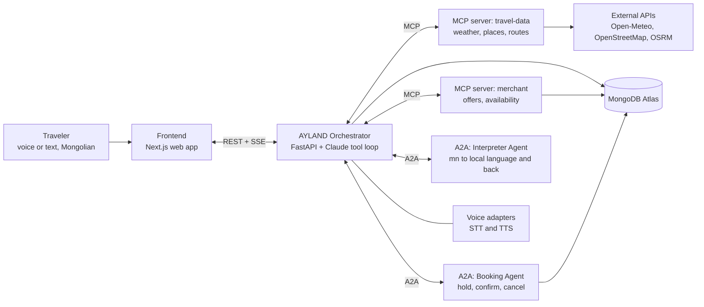
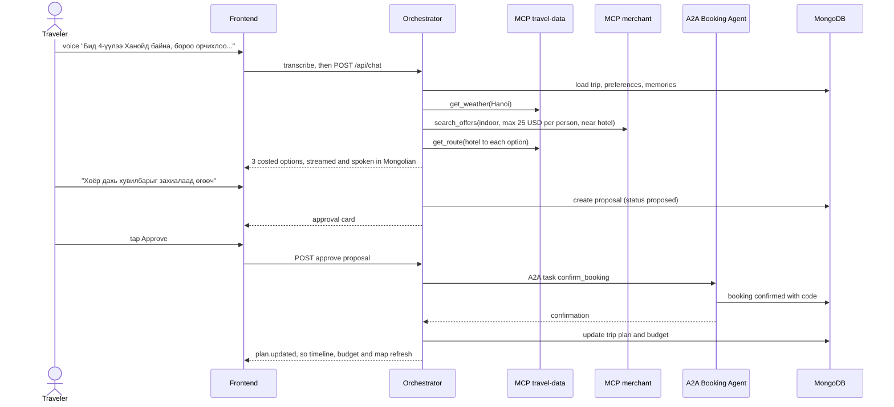

# AYLAND: Team Handbook

> **Аяллыг тань хөнгөвчлөх анд.** *A friend that makes your travel easier.*
>
> Team **Morgensonne** 🌅 · Hackathon theme: **Agentic Commerce** · Repo: [RedonaNova/AYLAND](https://github.com/RedonaNova/AYLAND)

This handbook is our single source of truth for **what** we build, **how** the pieces fit together, and **in what order** we build them.

- **First time here?** Read §1 to §4 (about 10 minutes).
- **While coding,** keep §7 (repo layout), §8 (contracts) and §10 (roadmap) open.
- **Status:** v1 draft (2026-09-30). Anything marked *Proposed* gets confirmed at kickoff (see §6).

---

## Contents

1. [TL;DR](#1-tldr)
2. [The concept](#2-the-concept)
3. [The demo we are building toward](#3-the-demo-we-are-building-toward)
4. [Scope](#4-scope)
5. [Architecture](#5-architecture)
6. [Tech stack and decisions](#6-tech-stack-and-decisions)
7. [Repository layout](#7-repository-layout)
8. [Contracts v1](#8-contracts-v1)
9. [Team and workstreams](#9-team-and-workstreams)
10. [Roadmap: milestones and tasks](#10-roadmap-milestones-and-tasks)
11. [Ways of working](#11-ways-of-working)
12. [Local setup](#12-local-setup)
13. [Demo-day checklist](#13-demo-day-checklist)
14. [Risks and mitigations](#14-risks-and-mitigations)
15. [Glossary and references](#15-glossary-and-references)

---

## 1. TL;DR

- **What:** AYLAND is an AI travel companion for independent Mongolian travelers. It does more than suggest. It **plans, compares, books with your consent, re-plans when things change, and interprets** for you in the local language.
- **The magic moment:** a traveler says in Mongolian *"Бид 4-үүлээ Ханойд байна, бороо орчихлоо, өнөөдөр 100$ дотор юу хийж болох вэ?"* ("The four of us are in Hanoi, it's raining, what can we do today for under $100?"). AYLAND checks the real weather, the group's plan and local offers, proposes costed options and books one after approval. The day's plan then updates itself.
- **Core tech:** **MongoDB** holds memory and state. **MCP** supplies tools and data. **A2A** lets agents work together. **Claude** does the reasoning.
- **Golden rule:** by milestone **M4** the magic moment must work end to end (by text). Everything after that is a bonus.

---

## 2. The concept

The original concept (in Mongolian) is [docs/concept/Morgensonne.docx](docs/concept/Morgensonne.docx). English summary:

**What is new.** Today's travel apps give you lists and leave the work to you. AYLAND takes your goal (where, when, budget, travel style) and runs the whole trip. It researches flights, stays, transport, food and attractions, compares them, recommends the best fit and, **with your permission**, books them. If the weather, your location, budget or schedule changes mid-trip, it re-plans routes and bookings. It speaks Mongolian and acts as an **interpreter** with locals. It is one smart travel partner for the whole journey.

**Value created.**

| For | Value |
|---|---|
| Travelers | Less time planning, a personal trip, and everything (plans, tickets, bookings) in one place |
| Merchants and service providers | Reach the right traveler at the right moment, which means more bookings and sales |
| Travel ecosystem | Stays, transport, food and attractions that were separate become one connected flow, which gives **small and local businesses** a new channel to travelers |

### 2.1 The 14 agent capabilities and what we build this hackathon

| # | Capability (from the concept doc) | Level | Where it lives |
|---|---|---|---|
| 1 | Understand trip goals: budget, dates, interests, group size, style | **Must** | Orchestrator prompt, `users` and `trips` |
| 2 | Route planning: order, paths, timing | Should | `get_route` tool, planner prompt |
| 3 | Search flights, stays, transport, attractions via real APIs | **Must** for activities, weather and places. Stretch for flights and hotels | MCP `travel-data`, MCP `merchant` |
| 4 | Compare options by price, location, rating, time, conditions | **Must** | Orchestrator reasoning over tool results |
| 5 | Personalized recommendations for the group | **Must** | `memories`, traveler preferences |
| 6 | Budget tracking | **Must** | `get_budget_status`, budget meter UI |
| 7 | Booking with the user's consent | **Must** ★ | Approval card, then the A2A Booking Agent |
| 8 | Real-time re-planning (weather, delays, closures, budget) | **Must** ★ | `update_trip_plan`, weather tool |
| 9 | Daily itinerary | Should | Timeline UI, planner |
| 10 | Maps and directions | Should | `get_route`, Leaflet map |
| 11 | Interpreter (Mongolian ⇄ local language) | **Must** | A2A Interpreter Agent, STT/TTS |
| 12 | All trip info in one place (tickets, bookings, addresses, confirmations) | **Must** | MongoDB `trips` and `bookings`, trip panel |
| 13 | Coordinate group preferences | Should: group size and shared budget. Stretch: per-person preferences | `trips.travelers` |
| 14 | Proactively suggest the next step | Should | Nudge cards after events (rain, booking) |

★ = part of the magic moment.

---

## 3. The demo we are building toward

Every task in this plan serves this story of about three minutes. **If a task does not make this demo better or more reliable, it goes to the stretch list.**

**Setting:** Bat and three friends (four Mongolians) are on day 3 of a Hanoi trip that AYLAND planned. Today's plan is mostly outdoors, and they have $100 left for the day.

| Act | What happens | What the judges see | Capabilities |
|---|---|---|---|
| **0. Context** (15s) | Open the app: today's timeline, budget and map | A real trip, not an empty chat box | 9, 12 |
| **1. Rain** (15s) | The weather turns to rain (DEMO_MODE scenario). AYLAND flags it on its own: *"Бороо орж эхэллээ. Өнөөдрийн хоёр гадаа хөтөлбөрт нөлөөлөх тул өөрчлөх үү?"* | The agent notices the change without being asked | 8, 14 |
| **2. Ask** (60s) | Bat holds the mic: *"Бид 4-үүлээ Ханойд байна, бороо орчихлоо, өнөөдөр 100$ дотор юу хийж болох вэ?"* | The trace panel lights up: weather, trip, offers, routes. Two or three options appear with per-person and total cost and travel time, spoken back in Mongolian | 1, 3, 4, 5, 6, 10 |
| **3. Act** (45s) | *"Хоёр дахь хувилбарыг захиалаад өгөөч."* An approval card appears and Bat taps **Approve** | An A2A call to the Booking Agent returns a confirmation code. The timeline re-flows, the budget meter drops and the map pin moves | 7, 8, 12 |
| **4. Companion** (45s) | Interpreter mode at the venue: Mongolian ⇄ Vietnamese, by voice with large text on screen | A real conversation across two languages | 11 |
| **Close** (15s) | *"Not a chatbot. An agent that decides and acts, with your consent. MongoDB remembers, MCP connects, A2A collaborates."* | | |

**Why we need DEMO_MODE:** it may not be raining in Hanoi on demo day. The weather tool supports a scenario override (`data/scenarios/hanoi_rain.json`), so the story is reproducible. Everything else stays real: the tool calls, the reasoning, the booking and the database writes. If judges ask, we say so openly.

---

## 4. Scope

**Must** (the demo breaks without these)
- Mongolian chat (text) with streamed replies
- MCP servers: `travel-data` (weather with scenario override, places, routes) and `merchant` (offer search, availability)
- Trip state in MongoDB: plan, budget, bookings, and a re-plan tool
- Consent-gated booking through the A2A Booking Agent
- UI: chat, option cards, approval card, today's timeline, budget meter, agent trace panel
- Mongolian voice in and out, and interpreter mode (mn ⇄ vi)
- Seed data for Hanoi and a one-command demo reset

**Should** (makes it impressive)
- Map with pins and a route line
- Proactive nudges ("it's raining", "leave in 10 minutes")
- Atlas Vector Search for semantic offer search and agent memory
- Per-traveler interests inside the group

**Could** (stretch, only after M4 is tagged)
- A pre-trip planning flow from scratch, including flights and stays through a real API in test mode
- An A2A Transport Agent (ride options)
- Payment mandates in the style of AP2 (Agent Payments Protocol, an A2A extension for agent-initiated payments)
- A merchant portal where local businesses list their own offers
- MongoDB Change Streams for live sync across devices
- Prices shown in MNT as well

**Won't** (not this hackathon)
- Real payments, real bookings with real merchants, user accounts beyond one demo user, a native mobile app

---

## 5. Architecture



### 5.1 Components

| Component | Tech | Responsibility | Port |
|---|---|---|---|
| Frontend | Next.js, TypeScript, Tailwind | Chat and voice UI, timeline, budget, map, trace panel, interpreter screen | 3000 |
| Orchestrator | Python, FastAPI, Anthropic SDK | The main AYLAND agent. Understands the goal, calls tools, streams events and owns the consent gate | 8000 |
| MCP `travel-data` | Python, MCP SDK (FastMCP) | Weather (Open-Meteo plus scenario override), places, routes | 8201 |
| MCP `merchant` | Python, MCP SDK (FastMCP) | Offer catalog search and availability, backed by MongoDB | 8202 |
| A2A Booking Agent | Python, `a2a-sdk` | Hold, confirm and cancel bookings; writes to `bookings` | 8301 |
| A2A Interpreter Agent | Python, `a2a-sdk`, Claude | Translate Mongolian ⇄ local language with travel context | 8302 |
| Voice adapters | Module inside the orchestrator | Wraps the STT and TTS provider chosen in task M0-4 | none |
| Database | MongoDB Atlas (free M0 cluster) | Users, trips, offers, proposals, bookings, memories, agent events | cloud |

### 5.2 Why each technology (for us and for the pitch)

- **MongoDB Atlas** is the agent's memory and the trip's source of truth. Documents fit itineraries naturally (a trip has days, a day has items). A geospatial index answers "near our hotel", Atlas Vector Search answers "indoor things for a rainy day" and recalls preferences, and `agent_events` is an audit log of every action the agent takes.
- **MCP** is how the agent gets tools and data. Each data source is an MCP server, so any agent can reuse the tools (our orchestrator, the Booking Agent, even Claude Desktop), and each one is testable on its own in the MCP Inspector.
- **A2A** is how agents cooperate. The orchestrator hands booking and interpretation to specialist agents that publish **Agent Cards**. The same open interface would let a real merchant or transport company plug in their own agent, which is our ecosystem story.
- **Claude** handles reasoning, Mongolian understanding and tool use.

### 5.3 The magic moment, step by step



### 5.4 Agent design principles

1. **Tools supply facts, the model supplies judgment.** Weather, prices, availability and travel times always come from tools. The model never invents a price.
2. **Propose is not execute (the consent gate).** The model can only *create a proposal*. Holding or confirming a booking happens only through `POST /api/proposals/{id}/approve`, which the user triggers. This is enforced in code, twice (orchestrator and Booking Agent), not only in the prompt. Plan edits that spend no money are allowed without approval because they are versioned and reversible.
3. **Everything is logged.** Every tool call, A2A call and plan change is written to `agent_events` and streamed to the UI trace panel. This is both our debugging log and our proof to judges that the agent is really acting.
4. **Mongolian first.** Replies default to Mongolian and stay short and easy to speak aloud (they go through TTS). Money is shown as total and per person, in USD.
5. **Always end with a next step.** Every reply suggests what to do next (capability 14).

---

## 6. Tech stack and decisions

We confirm these at kickoff (task M0-8). Change the status column when the team agrees.

| ID | Decision | Choice | Status |
|---|---|---|---|
| D1 | LLM | Claude through the Anthropic API, model `claude-opus-5-5`; tune `effort` for latency | Proposed |
| D2 | Backend language | Python 3.12 (installed and managed by `uv`) with FastAPI | Proposed |
| D3 | Frontend | Next.js (App Router), TypeScript, Tailwind; Leaflet with OpenStreetMap tiles for the map (no key needed) | Proposed |
| D4 | Voice (Mongolian STT and TTS) | Chosen after the spike in task M0-4 | **Open** |
| D5 | Places and routing data | OpenStreetMap (Overpass, OSRM), free. Google Maps Platform only if someone already has a key | Proposed |
| D6 | MCP transport | Streamable HTTP, so each server runs as its own process and can be tested alone | Proposed |
| D7 | Demo city and currency | Hanoi, USD | Confirmed (concept doc) |
| D8 | MongoDB driver | PyMongo async API (`AsyncMongoClient`). Motor is deprecated | Proposed |
| D9 | Hackathon logistics | Build window, deadline, submission format (repo, video, deck), judging criteria, demo length | **Open** |

**Backend libraries:** `fastapi`, `uvicorn`, `anthropic[mcp]` (Tool Runner plus MCP conversion helpers), `mcp` (official MCP SDK), `a2a-sdk` (official A2A SDK), `pymongo`, `pydantic`, `pydantic-settings`, `httpx`, `ruff`, `pytest`.

**Frontend libraries:** `next`, `react`, `tailwindcss`, `leaflet` and `react-leaflet`, plus shadcn/ui components if we want them.

**Voice candidates for the spike (M0-4).** Test each one with the same three Mongolian sentences and one Vietnamese sentence. Score accuracy and latency. The support notes below are what we believe; the spike's job is to verify them.
- **Chimege**, a Mongolian speech company with STT and TTS APIs
- **Azure AI Speech**, which lists Mongolian (mn-MN) STT and neural TTS voices
- **Google Cloud Speech-to-Text** with mn-MN
- **Browser Web Speech API**, the fastest to prototype, though quality and support vary by browser

Vietnamese (the interpreter's other side) is supported by most major providers.

> **Notes for the agent-core owner (D1)**
> - Build the loop with the Anthropic Python SDK **Tool Runner** (`client.beta.messages.tool_runner`). Expose MCP tools to it with `anthropic.lib.tools.mcp.async_mcp_tool`. Stream responses.
> - On `claude-opus-5-5`, thinking is adaptive and cannot be switched off. Control latency and cost with `output_config.effort` (default `medium`; try `low` for quick chat turns).
> - Forced `tool_choice` (`any` or `tool`) is rejected on this model. Use `auto` and steer with instructions.
> - Check `stop_reason` before reading content (handle `"refusal"`), and enable server-side fallbacks (`fallbacks: "default"` with beta `server-side-fallback-2026-07-01`).
> - If the interpreter feels too slow on this model, choosing a faster model for that one agent is a team decision. Record it as D1b.

---

## 7. Repository layout

We build this structure in task M0-6. Keep new code inside it; if something doesn't fit, raise it in team chat before adding a new top-level folder.

```
AYLAND/
├── HANDBOOK.md               ← you are here
├── README.md                 ← short intro + quick start
├── .env.example              ← every env var with no secrets (M0-6)
├── package.json              ← root scripts: setup, dev, seed (M0-6)
├── docs/
│   ├── concept/Morgensonne.docx   ← original concept (Mongolian)
│   ├── demo-script.md        ← exact words and clicks for the demo (M6)
│   └── pitch/                ← deck export (M6)
├── frontend/                 ← Next.js + TypeScript + Tailwind
│   └── src/
│       ├── app/              ← pages: / (chat), /trip, /interpreter
│       ├── components/       ← ChatPanel, VoiceButton, OptionCard, ApprovalCard,
│       │                       Timeline, BudgetMeter, TraceDrawer, MapView
│       ├── i18n/mn.ts        ← all Mongolian UI strings in one place
│       └── lib/api.ts        ← typed client for the orchestrator API (§8.4)
├── backend/                  ← one Python project (uv), several processes
│   ├── pyproject.toml
│   ├── ayland/
│   │   ├── config.py         ← reads .env, the only place that does
│   │   ├── db/               ← Mongo client, Pydantic models (§8.1), repositories
│   │   ├── orchestrator/     ← FastAPI app, agent loop, prompts/, SSE events
│   │   ├── mcp_servers/
│   │   │   ├── travel_data/  ← get_weather, search_places, get_route
│   │   │   └── merchant/     ← search_offers, get_offer, check_availability
│   │   ├── a2a_agents/
│   │   │   ├── booking/      ← hold / confirm / cancel
│   │   │   └── interpreter/  ← translate
│   │   └── voice/            ← STT and TTS provider adapters
│   ├── scripts/seed.py       ← loads data/seed into MongoDB; also the demo reset
│   └── tests/
└── data/
    ├── seed/                 ← demo user, Hanoi trip, merchants, offers (JSON)
    └── scenarios/            ← DEMO_MODE fixtures, e.g. hanoi_rain.json
```

---

## 8. Contracts v1

Contracts let everyone build in parallel against agreed shapes. **We freeze v1 at kickoff (M0-7).** After that, any change goes in the same PR as an update to this section, plus a heads-up in team chat.

**General rules**
- JSON field names are `snake_case` everywhere: MongoDB, Python and the API. The frontend does not convert them.
- Money: `{ "amount": 12.5, "currency": "USD", "per": "person" | "group" }`, rounded to 2 decimals. Always include `per` so per-person and group prices are never confused.
- Time: ISO 8601 with an offset. Each trip stores its timezone (`Asia/Ho_Chi_Minh`).
- Locations: GeoJSON `{ "type": "Point", "coordinates": [lon, lat] }`. Longitude comes first.

### 8.1 MongoDB collections

```js
users {
  _id, name, language: "mn",
  preferences: { interests: [], food: [], pace: "relaxed" | "normal" | "packed", notes }
}

trips {
  _id, owner_id, title,
  destination: { city: "Hanoi", country: "VN", timezone: "Asia/Ho_Chi_Minh", location },
  travelers: [ { name, interests: [] } ], party_size: 4,
  budget: { currency: "USD", total, daily_limit, spent },
  hotel: { name, address, location },
  days: [ { date: "YYYY-MM-DD", items: [PlanItem] } ],
  version, updated_at
}
PlanItem {
  item_id, start, end, kind: "activity" | "meal" | "transport" | "stay" | "free",
  title, place: { name, address, location }, cost: Money, indoor: bool,
  status: "planned" | "proposed" | "booked" | "cancelled" | "done",
  offer_id?, booking_id?, source: "seed" | "agent" | "user"
}

merchants  { _id, name, kind, city, contact }

offers {                                   // merchant catalog, seeded
  _id, merchant_id, city, title, title_mn, description,
  category: "activity" | "food" | "culture" | "wellness" | "transport",
  tags: ["indoor", "rainy-day", "family", "food", ...],
  price: Money, duration_min, location, address, rating, opening_hours,
  slots: [ { start, capacity_left } ], cancellation_policy,
  embedding?: [float]                      // Should: Atlas Vector Search
}

proposals  { _id, trip_id, offer_id, slot_start, party_size, total: Money,
             status: "proposed" | "approved" | "rejected" | "expired", created_at }

bookings   { _id, trip_id, proposal_id, offer_id, status: "held" | "confirmed" | "cancelled",
             confirmation_code, total: Money, consent: { approved_at, method: "tap" | "voice" }, created_at }

memories   { _id, user_id, trip_id?, kind: "preference" | "fact" | "feedback", text, embedding?, created_at }

messages   { _id, trip_id, role, content, ts }    // raw API content blocks, so chats can resume

agent_events { _id, trip_id, run_id, type: "tool" | "a2a" | "plan" | "booking" | "llm",
               name, input, output_summary, ok, ms, ts }
```

**Indexes:** `offers.location` (2dsphere), `proposals.trip_id`, `bookings.trip_id`, `messages (trip_id, ts)`, `agent_events (trip_id, ts)`. *Should:* Atlas Vector Search indexes on `offers.embedding` and `memories.embedding`.

### 8.2 Tools

**MCP server `travel-data`**

| Tool | Input | Output |
|---|---|---|
| `get_weather` | `city` or `lat`/`lon`, `hours_ahead` | Current conditions plus hourly `condition`, `precip_prob`, `temp_c`; `scenario: true` when a DEMO_MODE override is active |
| `search_places` | `query`, `near`, `radius_m`, `kind` | `[ { name, address, location, rating?, source } ]` |
| `get_route` | `from`, `to`, `mode` (`walk` / `drive`) | `{ distance_m, duration_min, polyline? }` |

**MCP server `merchant`**

| Tool | Input | Output |
|---|---|---|
| `search_offers` | `city`, `query` (free text), `tags[]`, `max_price_per_person`, `party_size`, `near`, `radius_m`, `time_window` | Ranked offers, each with `price_total` for the party |
| `get_offer` | `offer_id` | Full offer |
| `check_availability` | `offer_id`, `date`, `party_size` | Available slots |

**Orchestrator local tools.** These are not MCP, because they touch our own state and the consent gate.

| Tool | Input | Output |
|---|---|---|
| `get_trip` | `trip_id` | Trip including today's plan |
| `get_budget_status` | `trip_id` | `{ total, spent, remaining_today }` |
| `update_trip_plan` | `trip_id`, `date`, `changes[]` (add / replace / cancel items), `reason` | New `version` plus a diff; emits `plan.updated` |
| `propose_booking` | `offer_id`, `slot_start`, `party_size` | A proposal with `status: proposed`; emits `proposal.created` |
| `remember` / `recall` *(Should)* | `text` / `query` | Writes a memory / returns the top-k memories |

### 8.3 A2A agents

**AYLAND Booking Agent** (port 8301) publishes an Agent Card with these skills:

| Skill | Input | Output |
|---|---|---|
| `hold_booking` | `offer_id`, `slot_start`, `party_size` | `{ hold_id, expires_at }` |
| `confirm_booking` | `proposal_id` | `{ booking_id, confirmation_code }`. **Refuses unless the proposal is `approved` in MongoDB** |
| `cancel_booking` | `booking_id` | `{ status }` |

**AYLAND Interpreter Agent** (port 8302):

| Skill | Input | Output |
|---|---|---|
| `translate` | `text`, `source_lang`, `target_lang`, `context?` | `{ text, pronunciation_hint? }` |
| `phrasebook` *(Should)* | `situation`, `target_lang` | Useful phrases for the situation |

### 8.4 Orchestrator HTTP API (for the frontend)

| Method | Path | Purpose |
|---|---|---|
| POST | `/api/chat` | `{ trip_id, message }` returns an SSE event stream (below) |
| POST | `/api/voice/transcribe` | Audio (multipart) and `lang`; returns `{ text }` |
| POST | `/api/voice/speak` | `{ text, lang }`; returns audio |
| POST | `/api/interpret` | `{ text, source_lang, target_lang }`; returns `{ text }` |
| GET | `/api/trips/{trip_id}` | Trip with plan, budget and bookings |
| POST | `/api/proposals/{id}/approve` | Consent: calls the Booking Agent over A2A, updates the plan, emits events |
| POST | `/api/proposals/{id}/reject` | Rejects the proposal |
| GET | `/api/trips/{trip_id}/events` | *(Should)* SSE stream of plan and booking updates and nudges |
| POST | `/api/demo/reset` | Re-seeds demo data (DEMO_MODE only) |
| POST | `/api/demo/scenario` | `{ weather }` set to `"rain"` or `"clear"` switches the scenario (DEMO_MODE only) |

**SSE event types**

| Event | Payload |
|---|---|
| `message.delta` | `{ text }` |
| `message.done` | `{ message_id }` |
| `tool.start` | `{ run_id, name, input }` |
| `tool.end` | `{ run_id, name, ok, summary, ms }` |
| `a2a.call` | `{ agent, skill, status }` |
| `proposal.created` | `{ proposal }` |
| `plan.updated` | `{ trip_id, version, changed_item_ids }` |
| `booking.confirmed` | `{ booking }` |
| `nudge` | `{ text, actions[] }` |
| `error` | `{ message }` |

---

## 9. Team and workstreams

Fill in names at kickoff. One owner per workstream; everyone helps at integration points.

| Workstream | Owns | Owner |
|---|---|---|
| **A: Agent core** | Orchestrator, prompts, tool loop, consent gate, nudges | _TBD_ |
| **B: Data and tools** | MongoDB models and indexes, seed data, both MCP servers, vector search | _TBD_ |
| **C: Experience** | Next.js UI, voice capture and playback, timeline, map, trace panel, interpreter screen | _TBD_ |
| **D: Agents and voice** | A2A Booking and Interpreter agents, STT and TTS adapters | _TBD_ |
| **Demo and pitch** | Demo script, deck, rehearsals, submission | Shared, led by _TBD_ |

- **Three people?** Split D: A takes the Booking Agent, B takes the Interpreter Agent and voice adapters.
- **Five people?** Give Demo and pitch a dedicated owner from M3 onward.

---

## 10. Roadmap: milestones and tasks

Times are **hours from kickoff (H0)** and assume a build window of about 24 hours. Rescale them once we confirm D9. Each milestone ends with an **exit check**. Do not start the next milestone's integration until the check passes on `main`.

| Milestone | Target | Exit check |
|---|---|---|
| **M0** Setup | H0 to H2 | Keys work, repo scaffolded, everyone runs it locally, D1 to D9 decided, contracts frozen |
| **M1** Walking skeleton | H2 to H5 | UI to orchestrator to Claude gives a streamed Mongolian reply; the seeded trip shows in the UI; A2A ping works |
| **M2** Tools via MCP | H5 to H9 | The rain question is answered with real tool calls, visible in the trace panel |
| **M3** Plan and budget | H8 to H12 | The agent re-plans; timeline and budget update live |
| **M4** ★ Magic moment (text) | H12 to H15 | Acts 2 and 3 run end to end from a fresh reset, 3 times in a row. Tag `v0.1-magic` |
| **M5** Voice and interpreter | H15 to H19 | The magic moment works by voice; the interpreter round trip mn ⇄ vi works |
| **M6** Demo hardening | H19 to H24 | Feature freeze at H20, 3 rehearsals, backup video, submission done |

Tick a box in the same PR that finishes the task. Task IDs (M2-B1 and so on) go in branch names and PR titles.

### M0: Setup (H0 to H2)

- [ ] **M0-1** (all) Read §1 to §4. Install Git, Node.js 20+ and `uv`. Clone the repo **outside OneDrive, Dropbox or iCloud folders**, because syncing `node_modules` and `.venv` breaks things.
- [ ] **M0-2** (B) Create the MongoDB Atlas free cluster `ayland`, a database user and network access. Share `MONGODB_URI` privately.
- [ ] **M0-3** (A) Create an Anthropic API key with a spend limit. Share it privately.
- [ ] **M0-4** (D) Voice spike (§6): run the same sentences through each candidate, record accuracy and latency, and fill in D4.
- [ ] **M0-5** (A) LLM spike: five Mongolian travel prompts, check quality and latency at effort `low` and `medium`, then confirm D1.
- [ ] **M0-6** (C) Scaffold the repo per §7: `create-next-app` in `frontend/`, a uv project in `backend/`, root `package.json` scripts, `.env.example`. Merge one small PR quickly so everyone can pull it.
- [ ] **M0-7** (all, 20 min) Walk through §8 together, adjust it, and mark it "frozen v1".
- [ ] **M0-8** (lead) Confirm D9: deadline, submission format, judging criteria, demo length. Fill in §9 names.

### M1: Walking skeleton (H2 to H5)

- [ ] **M1-A1** FastAPI app with `POST /api/chat` streaming a Claude reply (`message.delta`, `message.done`). System prompt v0 covers the persona, Mongolian and the rules in §5.4.
- [ ] **M1-A2** Store chat turns in `messages`.
- [ ] **M1-B1** `ayland/db`: client, Pydantic models for §8.1, small repository functions.
- [ ] **M1-B2** Seed data: the demo user; the Hanoi trip (today = the seed date, an outdoor-heavy plan, hotel in the Old Quarter); 25 to 30 realistic offers with a good share of indoor, rainy-day and budget options; and the merchants. `scripts/seed.py` must be idempotent so it doubles as the demo reset.
- [ ] **M1-C1** Mobile-first chat screen that reads the SSE stream, plus a trip panel from `GET /api/trips/{id}`.
- [ ] **M1-D1** Booking Agent skeleton that serves its Agent Card and a `ping` skill, plus an A2A client helper in the orchestrator that calls it.
- [ ] **M1-D2** Voice adapter interface (`transcribe(audio, lang)`, `speak(text, lang)`) using the provider chosen in D4, exposed as `/api/voice/*`.

### M2: Tools via MCP (H5 to H9)

- [ ] **M2-B1** MCP `travel-data`: `get_weather` (Open-Meteo plus the DEMO_MODE scenario), `search_places`, `get_route`.
- [ ] **M2-B2** MCP `merchant`: `search_offers` (filters plus a 2dsphere "near" query), `get_offer`, `check_availability`.
- [ ] **M2-B3** Exercise both servers in the MCP Inspector and add smoke tests in `backend/tests`.
- [ ] **M2-A1** The orchestrator loads the MCP tools (Tool Runner plus MCP helpers) and the local tools `get_trip` and `get_budget_status`.
- [ ] **M2-A2** Emit `tool.start` and `tool.end` and write `agent_events`.
- [ ] **M2-A3** Prompt v1: compare options, show per-person and total cost, respect the budget, end with a next step.
- [ ] **M2-C1** Trace panel: a live list of agent steps with status and timings.
- [ ] **M2-C2** Option cards: title, time, travel time, cost, and a one-line reason.
- [ ] **M2-D1** Interpreter Agent (A2A) with the `translate` skill.

### M3: Plan and budget (H8 to H12)

- [ ] **M3-A1** `update_trip_plan` tool (versioned and reversible) that emits `plan.updated`.
- [ ] **M3-A2** `propose_booking` tool that writes to `proposals` and emits `proposal.created`.
- [ ] **M3-B1** Budget service: planned, booked and remaining for today.
- [ ] **M3-B2** *(Should)* Embed offers, create the Atlas Vector Search index, and use semantic search inside `search_offers`.
- [ ] **M3-B3** *(Should)* `remember` and `recall` tools on `memories`.
- [ ] **M3-C1** Today's timeline with live updates on `plan.updated`, plus the budget meter.
- [ ] **M3-C2** *(Should)* Map with the hotel and plan items as pins and a route line to the next item.

### M4: ★ Magic moment, text version (H12 to H15)

- [ ] **M4-D1** Booking Agent skills `hold_booking`, `confirm_booking` and `cancel_booking`, writing to `bookings` with a confirmation code. It must refuse any proposal that is not `approved`.
- [ ] **M4-A1** `approve` and `reject` endpoints: A2A call, then plan item set to `booked`, budget updated, events emitted, and a short Mongolian summary from Claude.
- [ ] **M4-C1** Approval card (what, when, how many people, total, cancellation policy) with **Approve**, **Change** and **Decline**.
- [ ] **M4-B1** `/api/demo/reset` and `/api/demo/scenario`.
- [ ] **M4-ALL** Run the text flow from a fresh reset 3 times in a row, fix any flakiness, then tag `v0.1-magic`.

### M5: Voice and interpreter (H15 to H19)

- [ ] **M5-C1** Push-to-talk mic: record, transcribe, show the transcript, send to chat. Replies play through TTS (with a mute toggle).
- [ ] **M5-C2** Interpreter screen: two large buttons ("Би" and "Тэд"), large translated text for showing to locals, audio playback.
- [ ] **M5-D1** Interpreter flow: STT in the source language, A2A `translate`, TTS in the target language. The target language comes from the trip destination.
- [ ] **M5-A1** Nudges: a rain alert when the scenario changes, and "time to leave" after a booking, using `get_route`.
- [ ] **M5-A2** *(Should)* Voice approval: saying "Тийм, захиал" approves the card currently on screen. The card must still be visible.

### M6: Demo hardening and pitch (H19 to H24)

- [ ] **M6-1** Feature freeze at H20. After that, bug fixes only.
- [ ] **M6-2** `docs/demo-script.md`: exact words, clicks and fallback lines for each act in §3.
- [ ] **M6-3** Record a backup video of the full demo.
- [ ] **M6-4** Pitch deck: problem, AYLAND, live demo, how it works (MongoDB, MCP, A2A), value for travelers, merchants and the ecosystem, what's next, team.
- [ ] **M6-5** README: what it is, architecture diagram, how to run it, team.
- [ ] **M6-6** Rehearse 3 times with a timer. Decide who speaks and who drives.
- [ ] **M6-7** Submit.

---

## 11. Ways of working

### Git workflow

- **`main` is always demo-able.** Never push something to `main` that breaks the running app.
- **Branch names:** `<type>/<task-id>-<short-name>`, for example `feat/M2-B1-weather-tool` or `fix/M1-C1-sse-reconnect`. Types: `feat`, `fix`, `docs`, `chore`, `refactor`.
- **Commits** follow Conventional Commits with an area: `feat(mcp): add get_weather with scenario override`. Areas: `web`, `agent`, `mcp`, `a2a`, `voice`, `db`, `demo`, `docs`.
- **Flow:**
  ```bash
  git switch main && git pull
  git switch -c feat/M2-B1-weather-tool
  # ...small commits...
  git pull --rebase origin main
  git push -u origin feat/M2-B1-weather-tool
  # open a PR; a teammate glances at it (10 minutes max); squash-merge
  ```
- **Branches live less than 3 hours.** Merge small and often.
- **Never** force-push `main`, and **never** commit `.env` or any key. **The repo is public.**
- **Contract changes (§8)** update this handbook in the same PR, with a heads-up in team chat.

### Sync rhythm

- A 5-minute stand-up at each milestone boundary (about every 3 hours): done, next, blocked.
- Blocked for more than 30 minutes? Ask the team.
- Everyone merges before a milestone's exit check. That is our integration moment.

### Definition of done

- It works on `main` after a fresh pull, following the README.
- New env vars are in `.env.example`; new or changed contracts are in §8.
- The magic-moment flow still works (from M4 onward, run it before merging).
- The task box is ticked in this handbook.

### Code conventions

- **Language:** English for code, comments and commits. Mongolian for user-facing text, kept in one place per app (`frontend/src/i18n/mn.ts`, `backend/ayland/orchestrator/prompts/`).
- **Python:** type hints, Pydantic models, async I/O, `ruff format` and `ruff check`.
- **TypeScript:** strict mode, the ESLint config from `create-next-app`, API types in `lib/api.ts` that mirror §8.
- **Config:** secrets only come from env vars, and only `ayland/config.py` reads them.
- **Logging:** every agent action goes to `agent_events`. It is both our demo trace and our debug log.

### Using AI coding assistants

Give the assistant this handbook first (§7 and §8 especially), so its code matches our structure and contracts. Review what it writes before you commit, and keep PRs small.

---

## 12. Local setup

**Prerequisites:** Git, Node.js 20+, and [uv](https://docs.astral.sh/uv/), which installs Python 3.12 for us.

The commands below are the target experience. Task M0-6 makes them real, and this section is updated in that PR.

```bash
git clone https://github.com/RedonaNova/AYLAND.git
cd AYLAND
cp .env.example .env     # fill in keys (ask the team, never paste them in chat groups)
npm run setup            # installs frontend + backend dependencies
npm run seed             # loads demo data into MongoDB (also the demo reset)
npm run dev              # starts web, orchestrator, both MCP servers, both A2A agents
```

**Environment variables** (`.env.example`):

```bash
# LLM
ANTHROPIC_API_KEY=
AYLAND_MODEL=claude-opus-5-5

# Database
MONGODB_URI=
MONGODB_DB=ayland

# Voice (fill in after D4)
STT_PROVIDER=
TTS_PROVIDER=

# Optional data providers
GOOGLE_MAPS_API_KEY=
VOYAGE_API_KEY=            # embeddings for vector search (Should)

# Local service URLs
ORCHESTRATOR_URL=http://localhost:8000
MCP_TRAVEL_DATA_URL=http://localhost:8201/mcp
MCP_MERCHANT_URL=http://localhost:8202/mcp
A2A_BOOKING_URL=http://localhost:8301
A2A_INTERPRETER_URL=http://localhost:8302

# Demo
DEMO_MODE=true
DEMO_SCENARIO=hanoi_rain
```

**Handy tools**
- **MCP Inspector** (`npx @modelcontextprotocol/inspector`) to call MCP tools by hand.
- **MongoDB Compass** or the Atlas UI to look at the data.
- The official **MongoDB MCP Server** lets your AI assistant inspect the dev database.

---

## 13. Demo-day checklist

- [ ] Run `npm run seed` (reset) 10 minutes before going on stage
- [ ] DEMO_MODE is on and the scenario is set to `clear`, ready to switch to `rain` live
- [ ] Mic tested **in the room**; the transcript shows before sending
- [ ] Laptop charged, notifications off, browser zoom set, only the needed tabs open
- [ ] Phone hotspot ready as a network backup
- [ ] Backup video open in another tab
- [ ] API keys have credit and are under their rate limits
- [ ] One person speaks, one person drives

---

## 14. Risks and mitigations

| Risk | Mitigation |
|---|---|
| Mongolian STT mishears in a noisy room | Show the transcript before sending, allow typing as a fallback, test in the room, use rehearsed phrasing |
| It isn't raining in Hanoi on demo day | DEMO_MODE scenario override (§3) |
| The LLM feels slow on stage | Stream tokens and show the trace panel so waiting looks like work, tune `effort`, keep the tool list small |
| Free APIs rate-limit us (Open-Meteo, Overpass, OSRM) | Cache responses in MongoDB; fixtures in DEMO_MODE |
| Wi-Fi fails | Phone hotspot, backup video |
| Integration hell at the end | Contracts frozen at M0, integration at every milestone, `main` always runs |
| Scope creep | MoSCoW in §4; stretch work only after `v0.1-magic` is tagged |
| The agent books the wrong thing | Consent gate enforced in code, checked by both the orchestrator and the Booking Agent |
| A secret leaks through the public repo | `.env` is gitignored, keys are shared privately, all keys are rotated after the hackathon |

---

## 15. Glossary and references

| Term | Meaning |
|---|---|
| **Agentic commerce** | An AI agent that doesn't only advise but takes commercial actions (holding, booking, paying) for a user, within limits the user sets |
| **MCP** (Model Context Protocol) | An open protocol that connects agents to tools and data. Our tools live in MCP servers |
| **A2A** (Agent2Agent) | An open protocol for agents to discover each other (through **Agent Cards**) and delegate tasks |
| **Consent gate** | Our rule that money-spending actions only run after an explicit user approval, enforced in code |
| **SSE** (Server-Sent Events) | One-way streaming from server to browser, used for tokens and agent events |
| **Atlas Vector Search** | MongoDB search by meaning (embeddings), for example "indoor rainy-day activities" |
| **2dsphere index** | MongoDB geospatial index for "near this point" queries |
| **STT / TTS** | Speech-to-text and text-to-speech |
| **DEMO_MODE** | Scenario overrides (such as forced rain) that make the live demo reproducible |

**References**
- MCP: https://modelcontextprotocol.io
- A2A: https://a2a-protocol.org
- MongoDB Atlas Vector Search: https://www.mongodb.com/docs/atlas/atlas-vector-search/
- Claude tool use: https://platform.claude.com/docs/en/agents-and-tools/tool-use/overview
- Open-Meteo (free weather API): https://open-meteo.com

---

### Changelog

| Date | Version | Change |
|---|---|---|
| 2026-09-30 | v1 | First handbook, based on Morgensonne.docx |
